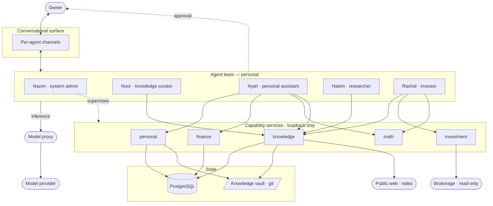

# Architecture

nizam-os is a private AI operating system for one person, running on a single
self-hosted machine. A small team of agents each own a domain of the owner's
life. They are reached through one conversational surface, they call capability
services over a loopback interface, and they run as supervised processes under
a single user account. The machine itself is invisible in normal operation.

**Scope: the personal domain.** The business coordination layer and the C-suite
roles are deferred to a later cycle and are not described here.

> **Placeholders.** Where a decision depends on an unresolved question in
> `docs/SRS.md` or `docs/PRD.md`, this document carries a
> `[PENDING — SRS Q<n>]` marker instead of an assumption. Nothing marked that
> way has been guessed. Resolve the question and the marker names exactly what
> to fill. Find them all with `grep -rn "PENDING" docs/`.

---

## 1. Shape of the system

Three rules hold everywhere and explain most of the diagram:

- **No agent touches state directly.** Every read and write goes through a
  capability service. Agents hold no database credentials.
- **No agent reaches a model provider directly.** All inference goes through
  one proxy. *(C-04)*
- **Nothing changes without the owner.** Every state-changing action returns to
  him for approval before it executes. *(FR.06.2.1)*

---

## 2. Agent roster — personal

Five agents. Each has a mandate, its own memory, its own channels, and a
declared capability set. Anything outside that set is invisible to it.

| Agent | Owns | Serves | Distinguishing capability |
| :--- | :--- | :--- | :--- |
| **Nazim** — system admin | The system's own health | CP.04 | The only agent permitted to execute commands on the host, restricted to an explicit allowlist |
| **Noor** — knowledge curator | Capture, classification and retrieval of what the owner reads | CP.03 | Two-pass ingestion: draft, approve, then write |
| **Ayah** — personal assistant | Money, tasks, habits, goals, journal, daily briefings | CP.01, CP.02, CP.05 | The only agent that writes personal or financial state |
| **Hakim** — researcher | Multi-source research on demand | CP.03, CP.07 | Delegates to sub-agents; works through files rather than holding everything in context |
| **Rashid** — investor | Investment due diligence and compliance screening | CP.07 | Reads the brokerage; holds no capability to place an order *(FR.07.1.2)* |

**Why five and not one.** A single agent with every capability would have every
capability available on every turn, which makes the blast radius of one bad
instruction the whole system. Splitting by domain means a compromised or
confused agent can only reach its own domain — the containment is structural,
not behavioural. It also keeps each agent's context small enough to reason well.

### Delegation

Hakim and Rashid may spawn sub-agents; the others may not. Rashid delegates
research to Hakim and keeps analysis and judgment for itself. Delegation is
bounded in both depth and concurrency, sub-agent actions remain subject to the
approval gate, and a sub-agent never addresses the owner directly — its parent
synthesises and speaks. *(FR.06.4.4)*

---

## 3. Capability services

A service is a long-lived process exposing a set of tools over loopback. It
serves whichever agents are permitted to call it and knows nothing about which
agent is calling.

| Service | Owns | Called by | State |
| :--- | :--- | :--- | :--- |
| **knowledge** | Vault ingestion, classification, indexing, search | Noor, Hakim, Rashid, Ayah (read) | `knowledge` schema + the vault |
| **personal** | Tasks, habits, goals, journal | Ayah | `personal` schema + journal files |
| **finance** | Transactions, accounts, budgets, reconciliation, zakat | Ayah | `finance_personal` schema |
| **math** | Exact arithmetic on money | Ayah, Rashid | None — stateless |
| **investment** | Brokerage reads: positions, watchlist, prices, filings | Rashid | None — the brokerage is the record *(FR.07.1.3)* |

**Agents and services are independent.** A service does not know its caller.
Adding capability means building or extending a service, never editing an
agent. This is what makes the roster cheap to change.

**Why `math` is separate.** Money arithmetic must be exact *(NFR.05)*, and an
agent that does arithmetic inside its own reasoning will eventually get it
wrong in a way nothing detects. Making it a callable capability means every
financial figure has a verifiable derivation.

---

## 4. State

### PostgreSQL

One instance, one database, one schema per domain. Each service connects as its
own role holding grants on exactly the schemas it needs — isolation enforced by
the database, not by convention. *(NFR.11, FR.06.1.3)*

| Schema | Owner | Contents |
| :--- | :--- | :--- |
| `audit` | Shared | Append-only record of every change, by every service |
| `knowledge` | knowledge | Vault index and embeddings |
| `personal` | personal | Tasks, habits, habit logs, goals, journal index |
| `finance_personal` | finance | Accounts, transactions, transfers, categories, budgets, savings, amortisation |

**The audit invariant.** No service role holds UPDATE or DELETE on the audit
record. Append-only by grant, not by discipline — the system cannot rewrite its
own history even if instructed to. *(FR.06.3.2, AC.07)*

### The vault

Markdown notes with structured frontmatter, in a git repository. **The file is
authoritative; the database index is derived and rebuildable from the files
alone.** *(NFR.07, NFR.08)*

This split is deliberate. Knowledge must survive the system that indexes it —
if the database is lost, the notes are intact and the index rebuilds. The
reverse is not acceptable.

Journal entries follow the same rule: the vault file is the record, the
database copy exists only so the entry is searchable. A write that succeeds in
one and fails in the other is a failure, not a partial success.
*(FR.05.3.2, F-08)*

---

## 5. Load-bearing decisions

Each of these was a fork where the alternative was reasonable.

### One proxy in front of all inference

Every model call routes through a single local proxy. Cost, token accounting,
caching and key custody are centralised, provider changes are a configuration
edit rather than a code change, and there is exactly one place a spend ceiling
can be enforced *(NFR.13)*. The cost is that the proxy is a single point of
failure for all reasoning — see §7, and SRS open question 2, which is still
unanswered.

`[PENDING — SRS Q3]` The spend ceiling is designed but has no figure. The
enforcement point exists; the number does not.

### Long-lived services, not per-session processes

A service is one supervised process holding one connection pool, regardless of
how many agents are active. Spawning a process per agent session would multiply
memory and connections by the number of active agents on a machine whose memory
is the binding constraint *(C-03)*, and would pay a cold start on every
session.

### Approval gates writes, not reads

Reads execute freely; every state change goes to the owner first. The
asymmetry is the point: reads are recoverable and frequent, writes are
expensive to undo and comparatively rare. Gating reads would make the system
tiresome enough to stop using — which is the real failure mode for a tool whose
entire value is friction removal. *(FR.06.1.1, FR.06.2.1)*

The residual risk is acknowledged and not solved: a sufficiently plausible
request can still be approved. *(AC.02)*

### Money as integer sub-units

Every monetary amount is an integer in the currency's smallest unit. No
floating-point value ever represents money. Rounding error in financial
reporting is silent, compounding, and destroys trust in the figures — which
would defeat CP.01 entirely. *(NFR.05, FR.01.1.3)*

### Capability by declaration, never at runtime

No component may install software or acquire capability while running.
Everything an agent can do is declared ahead of time and reviewable. An agent
that can extend its own capability has no meaningful boundary. *(NFR.12, AC.04)*

### An interoperation boundary for future agents

The system exposes an agent-to-agent interface so that an agent built outside
it can be delegated a task and return a result, without any existing agent
being modified to accommodate it. *(FR.06.4.1, NFR.20)*

An external agent is bound by exactly the same rules as an internal one: the
approval gate applies, its capability set is declared and scoped, and its
identity is recorded on every action it contributes to. *(FR.06.4.2,
FR.06.4.3, NFR.21)* Interoperation widens who may participate; it does not
widen what may happen without the owner.

The alternative — extending the system only by editing its own agents — makes
every addition a modification of working code and eventually makes the roster
the bottleneck. This is a boundary decision made early because retrofitting a
containment model onto an already-open interface is far harder than declaring
it now.

### Skills carry behaviour; agent definitions carry mandate

An agent's own definition states what it is responsible for and what it may not
do. Task-specific procedure lives in separately attached skills. Adding a
capability is therefore writing a skill, not editing an agent — which keeps
agent definitions small no matter how much an agent can do, and keeps every
addition individually auditable.

---

## 6. Cross-cutting constraints

- **Nothing is publicly reachable.** Every component binds to loopback.
  Management access is over a private network path only. *(NFR.09)*
- **Secrets are encrypted at rest**, never committed in plaintext, and
  redacted from agent output on a best-effort basis. *(NFR.10, AC.05)*
- **Scheduled work is staggered.** No two heavy periodic processes start at the
  same wall-clock time — a memory-bound single machine cannot absorb concurrent
  spikes. *(C-03)*
- **Provisioning is idempotent.** Each phase ships one orchestrator script that
  reaches the same end state whether run once or repeatedly. It is the
  canonical way to set up, verify or recover a phase. *(NFR.17)*
- **Logging is uniform.** One structured format across services and scripts,
  shipped to one place, queryable alongside metrics. *(NFR.16)*
- **Every change is attributed** to the agent that made it, in the append-only
  audit record. *(NFR.15, FR.06.3.1)*

---

## 7. Failure posture

The system carries no Obligation-class problems — no contract, no regulator, no
second person harmed by an outage *(SRS §2)*. Availability is therefore not the
primary quality attribute. **Correctness and containment are.** A system that
is down for a day is recoverable; a system that silently records a wrong number
or takes an unwanted action is not.

That ordering drives the concrete behaviours:

| Situation | Required behaviour | Requirement |
| :--- | :--- | :--- |
| A financial input cannot be retrieved | Refuse to present a figure. Never substitute a stale value. | FR.01.5.2, FR.09/F-09 |
| A screening input is missing | Report inconclusive. Never assume. | FR.07.3.3 |
| Semantic retrieval is unavailable | Degrade to word-based search and say so. | FR.03.3.3 |
| A durable write half-succeeds | Report failure, never partial success. | FR.05.3.2 |
| A scheduled briefing does not run | Record and report the failure rather than skipping silently. | FR.02.2.3 |
| A component fails | Detect, attempt bounded recovery, escalate on exhaustion. | FR.04.1.1, FR.04.2.2 |
| Detection interval, restart deadline | `[PENDING — SRS Q4]` — NFR.04 proposes 5 minutes; unconfirmed. | NFR.04 |
| Boundary of safe unattended recovery | `[PENDING — SRS Q6]` — what the system must never attempt on its own is undrawn. Until it is, the permitted-action allowlist in `docs/RUNBOOK.md` cannot be finalised. | FR.04.2.1 |

**Open — the inference path.** The proxy is a hard dependency for every
reasoning capability. Whether the system should degrade to non-reasoning
recording and reporting when it is unavailable, or fail loudly, is unresolved.
It is SRS open question 2 and it changes the shape of every service's
interface, so it should be settled before service contracts are written.

---

## 8. Security posture

The realistic adversary is not an outsider. There is no public surface and
nothing to steal that anyone else wants. It is **the system's own autonomy** —
an agent acting on an instruction that was hallucinated, or injected through
content the system was asked to read. *(SRS §7.2)*

Controls are therefore concentrated on containment rather than perimeter:

- every state change requires the owner's approval;
- each agent holds only its declared capabilities;
- each service reaches only its own schema, enforced by the database;
- no component acquires capability at runtime;
- the change record cannot be altered by anything that writes to it.

The system holds Confidential data — financial records and journal entries —
and it both accepts input from and sends data to third parties. Two triggers
fire, so `docs/SECURITY.md` and `docs/THREAT-MODEL.md` are both mandatory
rather than optional, and they carry the detail.

---

## 9. Physical deployment

One self-hosted machine of fixed capacity, already in service. Every component
is co-resident: agents, services, database, and the observability stack. Memory
is the binding constraint and the reason for both the long-lived-service
decision and the staggered-scheduling rule.

Processes are supervised by the host's own init system. Deployment is running
an idempotent script; there is no build pipeline, no second environment and no
release process — appropriate for a single-user system with one operator, and
recorded here so that its absence reads as a decision rather than an omission.

Recovery procedures, the permitted-action allowlist for automated restarts, and
the retry bound are in `docs/RUNBOOK.md`.

---

## 10. What is deliberately not here

- **A second interface.** No web UI, no mobile app. One conversational surface
  is a requirement, not a limitation. *(C-02, FR.05.4.1)*
- **Horizontal scale.** One user. Growth is in stored history, not concurrency.
- **The business domain.** Deferred entirely to a later cycle.
- **Order placement.** The system advises; the owner executes. *(FR.07.1.2)*
