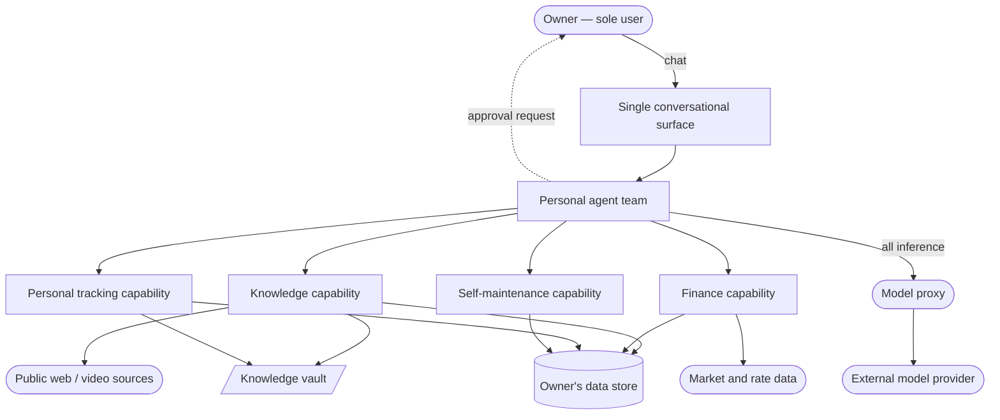

# Software Requirements Specification

**Project:** nizam-os
**Scope:** Personal domain only. Business domain deferred.
**Status:** DRAFT — derived from owner interrogation plus existing project
documentation. Items marked **[CONFIRM]** are inferred and need the owner's
confirmation or correction before this document is locked.

---

## 1. Introduction

### 1.1 Purpose

nizam-os is a private AI operating system for a single person. It replaces the
manual operational work of one owner's personal life with a small team of
autonomous agents, each owning a domain, all reachable through a single chat
surface. The purpose of this document is to state what the personal system must
do, traced from the owner's problems through to testable requirements.

### 1.2 Scope

**In scope — the personal domain.** Four capability areas, named by the owner:

1. **Personal finance** — current costs and forward planning.
2. **Learning and knowledge** — capture, retention and retrieval of what the
   owner reads and studies.
3. **Self-maintenance** — the system looks after its own infrastructure and
   application layer.
4. **Personal tracking** — tasks and habits, consolidated out of several
   separate mobile applications into one agentic surface.
5. **Research and investment review** — multi-source research as a capability
   the other areas draw on, and investment due diligence with religious
   compliance screening, read-and-advise only.

**Out of scope for this revision.** The business domain in its entirety — the
coordination layer and the CFO, COO, CTO and CMO roles, together with their
services and schemas. The owner's direction is explicit: *"let me limit myself
only to the personal aspect for now; once I master and build a proper system
that can help manage the personal things, we can then move to business."*
Business capability is a later cycle with its own requirements pass, not a
backlog item within this one.

Also out of scope: multi-tenancy or distribution of any kind, general-purpose
assistant behaviour, and any agent operating outside its declared domain.

### 1.3 Definitions and Acronyms

| Term | Meaning |
| :--- | :--- |
| Owner | The single human user of the system. Also its technical operator. |
| Agent | An autonomous LLM-driven process with a defined mandate, its own memory, and a scoped set of tools. |
| Service | A backing process exposing tools to agents over a local interface. Agents hold no direct database access. |
| Vault | The owner's knowledge store: Markdown notes with structured frontmatter, held in a git repository. |
| Approval gate | The rule that a state-changing action is presented to the owner and executed only after explicit confirmation. |
| Guardrail | A constraint that bounds autonomous action — scoped tool access, an allowlist, or a database grant. |
| Sub-unit | The smallest denomination of a currency (fils, cents). All stored monetary amounts are integers in sub-units. |
| CP / CN / FR / NFR / AC | Customer Problem / Customer Need / Functional Requirement / Non-Functional Requirement / Abuse Case. |

### 1.4 References

- `docs/reqs/raw.md` — interrogation record behind this document.
- `docs/PRD.md` — the product view of the same scope.
- `docs/ARCHITECTURE.md` — how the system is built. Deliberately not referenced
  by any requirement here; requirements stay in the problem space.

---

## 2. Problem Classification

**Notation:** `[Subject] [must/expects/hopes] [Object] [or Penalty]`

| ID | Problem Statement | Class | Penalty if Unmet |
| :--- | :--- | :--- | :--- |
| CP.01 | The owner **expects** to understand where his money goes — both overspending and underspending — or he continues operating blind on personal finances with no means of finding out. | E | Financial decisions are made without information. No hard loss has yet occurred. |
| CP.02 | The owner **expects** not to depend on his own memory for tasks and commitments, or he continues to miss deadlines. | E | Deadlines are already being missed. Cost lands on the owner. |
| CP.03 | The owner **expects** to retain and retrieve what he learns — he reads and studies heavily and has no system for note-taking or for finding things again — or the reading does not compound. | E | Effort spent reading is lost. Knowledge does not accumulate. |
| CP.04 | The owner **expects** the system to look after itself, infrastructure and application alike, or its upkeep becomes another manual task and defeats its purpose. | E | The system becomes a maintenance burden rather than a relief from one. |
| CP.05 | The owner **expects** personal tracking — tasks, habits — to live in one agentic surface rather than several separate mobile applications, or the fragmentation is itself the overhead. | E | Context-switching across applications consumes the attention the system exists to protect. |
| CP.06 | The owner **expects** the operational work of his life to happen without his manual effort, or it is done manually or not at all, consuming attention he wants spent on larger decisions. | E | Umbrella problem. Attention is the scarce resource being spent. |
| CP.07 | The owner **expects** to reach an investment decision on his own terms — including compliance with his religious constraints — without reading every annual report himself, or he either invests without due diligence or does not invest at all. | E | Capital is deployed uninformed, or opportunity is forgone. No hard penalty; the owner executes every trade himself. |

**No Obligations.** Every problem in the personal domain classifies as an
Expectation. Nothing here carries a contractual, regulatory or existential
penalty. This is recorded deliberately, because it sets what is proportionate:
there is no compliance regime, no external party is harmed by a failure, and a
day of downtime is recoverable. Security effort is therefore aimed at
containing the system's own autonomy, not at defending an asset from an
attacker with something to gain.

**[CONFIRM] — Zakat.** Zakat calculation has a due date and a correct amount,
which is the one candidate for Obligation class in this system. It is currently
recorded under CP.01 as an Expectation. If a mis-calculation or a missed
computation constitutes a hard failure, CP.01 splits and a new CP is raised at
class O, which would raise the correctness bar on all financial arithmetic.

---

## 3. Overall Description

### 3.1 Product Perspective

The system boundary contains the agent team, the capability services, the data
store and the vault. Outside it: the owner, the external model provider reached
only through a single proxy, and the public sources content is drawn from. The
dashed edge is load-bearing — every state-changing action inside the boundary
must be able to reach back out to the owner for approval.

### 3.2 Customer Needs

**Notation:** `[Subject] needs [system] to [Verb] [Object] [Condition]`

| ID | Need Statement | Outcome Class | Traces To |
| :--- | :--- | :--- | :--- |
| CN.01.1 | The owner needs the system to record every personal transaction at the moment he reports it, without him opening an application. | Construction | CP.01 |
| CN.01.2 | The owner needs the system to report where his money went over a period, broken down so that over- and under-spending are both visible. | Information | CP.01 |
| CN.01.3 | The owner needs the system to report his current position across all accounts he holds, in a single figure he can act on. | Information | CP.01 |
| CN.01.4 | The owner needs the system to compare actual spending against what he intended to spend, so a deviation is visible before the period ends. | Information | CP.01 |
| CN.01.5 | The owner needs the system to compute his zakat obligation when it falls due, from his own holdings and the prevailing threshold. | Information | CP.01 |
| CN.02.1 | The owner needs the system to capture a task the moment he states it, so that recording it costs him nothing. | Construction | CP.02 |
| CN.02.2 | The owner needs the system to tell him what is due and what is coming, unprompted, at a predictable time each day. | Information | CP.02 |
| CN.02.3 | The owner needs the system to hold the state of a commitment — open, done, abandoned — so that his memory is not the record. | Construction | CP.02 |
| CN.03.1 | The owner needs the system to take in a source he has found — a link, a video, a document — and turn it into a durable, retrievable note without manual filing. | Construction | CP.03 |
| CN.03.2 | The owner needs the system to classify what it captures, so that he never supplies the taxonomy himself. | Control | CP.03 |
| CN.03.3 | The owner needs the system to find a note again from a description of its meaning, not only from its exact words. | Information | CP.03 |
| CN.03.4 | The owner needs the system to show him what it intends to store before it stores it, so that a wrong capture is caught at the point of capture. | Information | CP.03 |
| CN.04.1 | The owner needs the system to detect that one of its own components has failed, without him having to look. | Information | CP.04 |
| CN.04.2 | The owner needs the system to restore a failed component to service on its own, where restoring it is safe. | Control | CP.04 |
| CN.04.3 | The owner needs the system to report what failed, what it did about it, and what remains wrong, in terms he can act on. | Information | CP.04 |
| CN.04.4 | The owner needs the system to answer questions about its own design and configuration, so that operating it does not require him to re-read its source. | Information | CP.04 |
| CN.05.1 | The owner needs the system to record a habit occurrence when he reports it, and to maintain the streak state that makes the habit worth tracking. | Construction | CP.05 |
| CN.05.2 | The owner needs the system to hold goals and relate work to them, so that tasks connect to intent. | Construction | CP.05 |
| CN.05.3 | The owner needs the system to accept a reflective entry and preserve it durably alongside the rest of his knowledge. | Construction | CP.05 |
| CN.05.4 | The owner needs one conversational surface for every personal domain, so that no capability requires a separate application. | Control | CP.05 |
| CN.06.1 | The owner needs the system to act on its own within stated limits, so that routine work does not wait on his attention. | Control | CP.06 |
| CN.06.2 | The owner needs the system to obtain his confirmation before any action that changes state, so that autonomy never becomes an unwanted action. | Control | CP.06 |
| CN.06.3 | The owner needs the system to record every change it makes, attributed to the agent that made it, so that its behaviour is reviewable after the fact. | Construction | CP.06 |
| CN.06.4 | The owner needs the system to accept a new agent, including one built elsewhere, without its existing agents being modified to accommodate it. | Control | CP.06 |
| CN.07.1 | The owner needs the system to report his current holdings and watchlist without him opening a brokerage interface. | Information | CP.07 |
| CN.07.2 | The owner needs the system to gather and synthesise the material behind an investment candidate, so that he is not the one reading the filings. | Construction | CP.07 |
| CN.07.3 | The owner needs the system to screen a candidate against his religious compliance constraints and state the result with its reasoning. | Information | CP.07 |
| CN.07.4 | The owner needs the system to preserve the reasoning behind a screening decision, so that a past decision can be revisited on its merits. | Construction | CP.07 |

### 3.3 User Personas

Defined by job-to-be-done.

- **The owner (sole user).** One person who runs his own personal life and, at
  a later stage, a business. **Job:** keep the operational layer of his life
  current — money recorded, commitments held, reading retained, system healthy
  — without opening an application, remembering to do it, or logging into a
  server, so his attention stays on decisions rather than upkeep.

- **The owner as operator (same person, different mode).** **Job:** understand
  what the system did, correct it when wrong, and extend it — without
  re-reading its source code to recall how it works.

There is no second persona. The system is single-user by design and has no
concept of a second identity.

### 3.4 Constraints

| # | Constraint | Origin |
| :--- | :--- | :--- |
| C-01 | Single owner. No second user, no roles, no tenancy, no external access surface. | Owner's stated scope. |
| C-02 | One conversational surface is the only interaction path. No web UI, no mobile app, no server login in normal operation. | CP.05, CN.05.4. |
| C-03 | Self-hosted on a single machine already in service. Cost is a fixed annual sum; the machine is not elastic. | Existing deployment. |
| C-04 | All model inference passes through one local proxy. No component reaches an external model provider directly. | Cost control, key containment. |
| C-05 | No component is reachable from the public internet other than the management path. | Existing posture. |
| C-06 | Every state-changing action requires the owner's approval. Read-only actions do not. | CN.06.2. |
| C-07 | Personal-domain scope only in this revision. | Owner's scope cut. |
| C-08 | Monetary amounts are held as integers in currency sub-units. No floating-point arithmetic on money. | Correctness of financial reporting. |
| C-09 | Existing infrastructure is in service and behaving. This revision does not re-platform it. | Owner: *"the infrastructure works quite well, there has been no issues with it."* |

### 3.5 Delivery Team & Existing Stack

**[CONFIRM] — this section is incomplete and is a coverage gap.**

Derived: the owner is the sole builder and maintainer, working with an AI
coding assistant. The stack already carrying production traffic on this machine
is Python for services, shell for provisioning and scheduled work, PostgreSQL
for storage, and systemd for process supervision.

Still needed: how much time per week is realistically available for building
this, and whether anyone else will ever need to operate it.

---

## 4. External Interface Requirements

### 4.1 Hardware Interfaces

A single self-hosted machine of fixed capacity, already provisioned. Memory is
the binding constraint: the agent team, the services, the datastore and the
observability stack are co-resident. No component may assume it can scale
horizontally, and no two heavy scheduled processes may start at the same
wall-clock time.

### 4.2 External Software Systems

| System | Role | Failure posture |
| :--- | :--- | :--- |
| Conversational platform | The sole owner-facing surface. | Hard dependency. Unavailable means no interaction at all. **[CONFIRM]** what the system should do when it is down. |
| Model provider (via local proxy) | All agent reasoning. | Hard dependency for agent action. Recording and reporting that need no reasoning should degrade rather than fail — **[CONFIRM]**. |
| Public web and video sources | Material for knowledge capture. | Soft. A failed fetch fails one capture. |
| Market/rate data source | Threshold and conversion figures for financial computation. | Soft, but a stale figure must never be presented as current. |
| Brokerage data (read-only) | Holdings and watchlist for investment review. | Soft. **In scope** (owner-confirmed 2026-09-10). Read-only; the system advises, the owner executes. |

### 4.3 Communication Protocols and Formats

- Owner ↔ system: natural-language conversation on the single surface.
- Agent ↔ capability service: structured tool invocation over a loopback-only
  interface. Agents never address the datastore directly.
- Notes: Markdown with structured frontmatter, in a version-controlled
  repository. The file is authoritative; any indexed copy is derived and
  rebuildable.
- Monetary values: integer sub-units with an explicit currency. Never a float.

---

## 5. Functional Requirements

RFC 2119 keywords. Every FR traces to a CN and transitively to a CP.

### CP.01 — Personal finance

| ID | Traces To | Priority | Requirement | Acceptance Criteria |
| :--- | :--- | :--- | :--- | :--- |
| FR.01.1.1 | CN.01.1 | MUST | The system shall record a personal transaction from a natural-language statement by the owner, capturing amount, currency, account, direction, category, date and counterparty. | A stated transaction is retrievable with every field populated; an unstated date defaults to the current date. |
| FR.01.1.2 | CN.01.1 | MUST | The system shall reject a transaction whose category is outside the owner's defined vocabulary, rather than inventing one. | A transaction with an unknown category is refused and the owner is asked to choose or define one. |
| FR.01.1.3 | CN.01.1 | MUST | The system shall store all monetary amounts as integers in the currency's smallest sub-unit. | No stored monetary value is a floating-point number. A round-trip of any amount returns it exactly. |
| FR.01.1.4 | CN.01.1 | SHOULD | The system shall record a transfer between two accounts the owner holds as a single transfer, preserving sent and received amounts separately when currencies differ. | A cross-currency transfer records both amounts and any fee, and does not appear as unexplained spending. |
| FR.01.2.1 | CN.01.2 | MUST | The system shall report total spending for a stated period, broken down by category. | For any closed period the sum of category totals equals the period total. |
| FR.01.2.2 | CN.01.2 | MUST | The system shall report spending for a period against the comparable prior period, so that a change in direction is visible. | The report states the difference per category, in both absolute and proportional terms. |
| FR.01.2.3 | CN.01.2 | SHOULD | The system shall spread irregular and recurring costs across the months they cover when reporting monthly cash flow. | An annually-billed subscription appears as a monthly figure in a monthly report, not as a single spike. |
| FR.01.3.1 | CN.01.3 | MUST | The system shall report the current balance of every account the owner holds, and a single total across them. | The total equals the sum of per-account balances converted to the owner's reporting currency at a stated rate. |
| FR.01.3.2 | CN.01.3 | MUST | The system shall state the conversion rate and its as-of time whenever it presents a converted total. | No converted figure is presented without its rate and timestamp. |
| FR.01.4.1 | CN.01.4 | SHOULD | The system shall hold an intended spending ceiling per category per month. | At most one ceiling is active per category at a time. |
| FR.01.4.2 | CN.01.4 | SHOULD | The system shall report actual spending against the intended ceiling before the period ends. | A category exceeding its ceiling is surfaced during the month, not after it closes. |
| FR.01.5.1 | CN.01.5 | MUST | The system shall compute the zakat obligation on demand from zakatable holdings and the prevailing threshold. | The computation states the threshold used, its source, its as-of time, the holdings included, and the resulting obligation. |
| FR.01.5.2 | CN.01.5 | MUST | The system shall refuse to present a zakat figure computed from a threshold it could not retrieve. | A failure to obtain a current threshold produces an explicit failure, never a figure derived from a stale or default value. |

### CP.02 — Tasks and commitments

| ID | Traces To | Priority | Requirement | Acceptance Criteria |
| :--- | :--- | :--- | :--- | :--- |
| FR.02.1.1 | CN.02.1 | MUST | The system shall create a task from a natural-language statement, capturing its description and, when stated, a due date and a priority. | A stated task is retrievable immediately and requires no further input to exist. |
| FR.02.1.2 | CN.02.1 | SHOULD | The system shall relate a task to a goal when the owner indicates one, and shall accept a task with no goal. | Both related and standalone tasks are valid and retrievable. |
| FR.02.2.1 | CN.02.2 | MUST | The system shall deliver an unprompted daily summary at a configured time, stating what is due, what is upcoming, and the owner's current financial position. | The summary arrives without the owner asking, at the configured time, on every day the system is running. |
| FR.02.2.2 | CN.02.2 | SHOULD | The system shall deliver an end-of-day summary of the day's spending and outstanding commitments, and shall open a thread for a reflective entry. | The evening summary arrives at its configured time and accepts a reply as a journal entry. |
| FR.02.2.3 | CN.02.2 | MUST | The system shall record a failure to deliver a scheduled summary, rather than skipping it silently. | A summary that could not be delivered leaves a retrievable record of the failure and its cause. |
| FR.02.3.1 | CN.02.3 | MUST | The system shall hold and transition the state of a task across open, complete and abandoned. | State transitions are retrievable, and a completed task is distinguishable from an abandoned one. |

### CP.03 — Learning and knowledge

| ID | Traces To | Priority | Requirement | Acceptance Criteria |
| :--- | :--- | :--- | :--- | :--- |
| FR.03.1.1 | CN.03.1 | MUST | The system shall accept a web link, a video link, or a document from the owner and produce a note containing the extracted content and its provenance. | The resulting note records the source, its retrieval time, and the extracted text. |
| FR.03.1.2 | CN.03.1 | MUST | The system shall persist a note as a file in the owner's vault, with the file as the authoritative copy. | The vault file exists and is complete; any index entry is derivable from it. |
| FR.03.1.3 | CN.03.1 | SHOULD | The system shall recover from a failed content extraction by attempting an alternative method before reporting failure. | A source that one method cannot extract is attempted by at least one other before the owner is told it failed. |
| FR.03.2.1 | CN.03.2 | MUST | The system shall propose the classification of a captured note — its title, subject areas and tags — without requiring the owner to supply them. | The owner is never asked to enter a taxonomy value manually. |
| FR.03.2.2 | CN.03.2 | MUST | The system shall restrict proposed subject areas to a controlled vocabulary, while leaving supplementary tags unrestricted. | A note's areas are always drawn from the defined vocabulary; tags may be arbitrary. |
| FR.03.3.1 | CN.03.3 | MUST | The system shall retrieve notes matching a description of their meaning, not only their literal wording. | A query phrased differently from a note's text still returns that note when the meaning corresponds. |
| FR.03.3.2 | CN.03.3 | MUST | The system shall combine meaning-based and word-based retrieval into a single ranked result. | A query whose terms appear literally and a query that only matches semantically both return the relevant note. |
| FR.03.3.3 | CN.03.3 | SHOULD | The system shall continue to return word-based results when meaning-based retrieval is unavailable, and shall say that it has degraded. | Loss of the embedding path degrades retrieval quality but does not fail the query, and the degradation is stated. |
| FR.03.4.1 | CN.03.4 | MUST | The system shall present the complete proposed note — content, title, classification and destination — to the owner and shall write it only after explicit approval. | No vault file is created without a preceding approval. Rejection leaves no trace in the vault. |
| FR.03.4.2 | CN.03.4 | MUST | The system shall keep the vault index consistent with the vault's files. | An approved write appears in retrieval; a rejected draft never does. |

### CP.04 — Self-maintenance

| ID | Traces To | Priority | Requirement | Acceptance Criteria |
| :--- | :--- | :--- | :--- | :--- |
| FR.04.1.1 | CN.04.1 | MUST | The system shall observe the running state of its own components and detect a failed one without owner involvement. | A deliberately stopped component is detected within a stated interval. |
| FR.04.2.1 | CN.04.2 | MUST | The system shall attempt to restore a failed component to service, restricted to an explicit list of permitted actions. | Restoration succeeds for a component whose failure is transient. No action outside the permitted list is ever taken. |
| FR.04.2.2 | CN.04.2 | MUST | The system shall stop attempting restoration after a stated number of failures and escalate to the owner. | Repeated failure produces one escalation, not an unbounded retry loop. |
| FR.04.3.1 | CN.04.3 | MUST | The system shall report each incident to the owner, stating what failed, what it attempted, the outcome, and what remains wrong. | The report is comprehensible without the owner inspecting logs or logging in. |
| FR.04.4.1 | CN.04.4 | SHOULD | The system shall answer the owner's questions about its own design, configuration and agent roster from its own documentation. | A question about how a component is configured is answered accurately, with its source named. |

### CP.05 — Personal tracking

| ID | Traces To | Priority | Requirement | Acceptance Criteria |
| :--- | :--- | :--- | :--- | :--- |
| FR.05.1.1 | CN.05.1 | MUST | The system shall record the completion of a habit on a given date from a natural-language statement. | A stated completion is recorded once for that date; a repeat statement does not double-count. |
| FR.05.1.2 | CN.05.1 | SHOULD | The system shall maintain the streak state of a habit according to its defined schedule, honouring rest days that do not break a streak. | A gap on a defined rest day leaves the streak intact; a gap on a scheduled day breaks it. |
| FR.05.2.1 | CN.05.2 | SHOULD | The system shall hold goals with an optional target date and a lifecycle state, and shall relate tasks to them. | A goal's related tasks are retrievable from the goal. |
| FR.05.3.1 | CN.05.3 | MUST | The system shall accept a reflective entry and persist it in the vault as the authoritative copy. | The entry is retrievable by search and its vault file is present. |
| FR.05.3.2 | CN.05.3 | MUST | The system shall not report a reflective entry as saved unless both its durable copy and its index entry succeeded. | A partial write is reported as a failure, never as a success. |
| FR.05.4.1 | CN.05.4 | MUST | The system shall expose every personal capability through the single conversational surface. | No personal capability requires a second application, a browser, or a server login. |

### CP.06 — Autonomy with guardrails

| ID | Traces To | Priority | Requirement | Acceptance Criteria |
| :--- | :--- | :--- | :--- | :--- |
| FR.06.1.1 | CN.06.1 | MUST | The system shall perform read-only actions without seeking approval. | A search, a lookup or a report executes directly. |
| FR.06.1.2 | CN.06.1 | MUST | The system shall restrict each agent to the specific capabilities its mandate requires, with capabilities outside that set unavailable to it. | An agent cannot invoke a capability outside its declared set, regardless of instruction. |
| FR.06.1.3 | CN.06.1 | MUST | The system shall confine each capability's data access to the domain it owns. | A capability cannot read or write data belonging to another domain, enforced below the application layer. |
| FR.06.2.1 | CN.06.2 | MUST | The system shall present every state-changing action to the owner and execute it only after explicit approval. | No creation, modification, deletion or state-changing command executes unapproved. |
| FR.06.2.2 | CN.06.2 | MUST | The system shall present an approval request in terms that identify the action and its effect. | The owner can tell from the request alone what will change. |
| FR.06.2.3 | CN.06.2 | MUST | The system shall accept instruction only from the owner's own identity, and shall ignore all others. | A message from any other identity produces no action. |
| FR.06.3.1 | CN.06.3 | MUST | The system shall record every change to owner data, attributed to the acting agent, with before and after state and a timestamp. | Every write is present in the record with its actor. |
| FR.06.3.2 | CN.06.3 | MUST | The system shall prevent modification or deletion of its own change record. | No component holds the ability to alter or remove a recorded change. |
| FR.06.3.3 | CN.06.3 | SHOULD | The system shall record the cost of its own model usage, attributed to the agent incurring it. | Consumption is retrievable per agent over a period. |

### CP.06 addendum — extensibility

| ID | Traces To | Priority | Requirement | Acceptance Criteria |
| :--- | :--- | :--- | :--- | :--- |
| FR.06.4.1 | CN.06.4 | SHOULD | The system shall expose an interoperation interface by which an agent outside the system may be delegated a task and return a result, without any existing agent being modified. | A newly introduced agent participates in delegation without a change to another agent's definition. |
| FR.06.4.2 | CN.06.4 | MUST | The system shall subject an external agent to the same approval gate and the same capability scoping as an internal one. | An external agent cannot cause a state change without the owner's approval, and holds no capability beyond its declared set. |
| FR.06.4.3 | CN.06.4 | MUST | The system shall record the identity of an external agent on every action it takes or contributes to. | The change record distinguishes an action originating from an external agent from an internal one. |
| FR.06.4.4 | CN.06.4 | SHOULD | The system shall bound the depth and concurrency of delegation, including delegation that crosses the system boundary. | A delegation chain cannot exceed its declared depth, and a bounded number of children run at once. |

### CP.07 — Investment review

| ID | Traces To | Priority | Requirement | Acceptance Criteria |
| :--- | :--- | :--- | :--- | :--- |
| FR.07.1.1 | CN.07.1 | MUST | The system shall report the owner's current positions and watchlist from the brokerage of record. | Reported holdings match the brokerage, with the retrieval time stated. |
| FR.07.1.2 | CN.07.1 | MUST | The system shall hold no capability to place, modify or cancel an order. | No order-placing capability exists in any agent's declared set. |
| FR.07.1.3 | CN.07.1 | MUST | The system shall treat the brokerage as the sole record of holdings, keeping no independent copy that could diverge. | No stored position figure exists that could contradict the brokerage. |
| FR.07.2.1 | CN.07.2 | SHOULD | The system shall gather source material on an investment candidate and synthesise it into a single assessment. | The assessment cites every source it drew on. |
| FR.07.2.2 | CN.07.2 | SHOULD | The system shall perform gathering work outside its reasoning context, so that a long task does not exhaust it. | A multi-source task completes without truncating its own inputs. |
| FR.07.3.1 | CN.07.3 | MUST | The system shall screen a candidate against the owner's declared compliance constraints and state pass or fail per constraint. | Each constraint is reported individually with the figure it was judged on. |
| FR.07.3.2 | CN.07.3 | MUST | The system shall state the source and as-of date of every financial figure used in a screening. | No screening figure is presented without provenance. |
| FR.07.3.3 | CN.07.3 | MUST | The system shall refuse to state a screening outcome when a required input could not be obtained. | A missing input yields an explicit inconclusive result, never an assumed one. |
| FR.07.3.4 | CN.07.3 | SHOULD | The system shall compute any purification obligation arising from a holding that passes screening with impermissible income. | The obligation states the ratio applied and the period covered. |
| FR.07.4.1 | CN.07.4 | MUST | The system shall persist the screening reasoning as a durable note alongside the owner's other knowledge. | The decision is retrievable later by search, with its inputs intact. |
| FR.07.4.2 | CN.07.4 | MUST | The system shall present an investment assessment as advice requiring the owner's own action, never as an executed decision. | Every assessment states that execution rests with the owner. |

---

## 6. Non-Functional Requirements

**[CONFIRM] — every target below marked so is a proposal, not an owner
statement.** Latency, uptime and budget were never elicited. These are the
numbers I would defend for a single-user self-hosted system; correct them and
they become binding.

| ID | Category | Priority | Requirement | Measurable Target |
| :--- | :--- | :--- | :--- | :--- |
| NFR.01 | Performance | SHOULD | Knowledge retrieval response | p95 under 3 s for a vault of 10,000 notes **[CONFIRM]** |
| NFR.02 | Performance | SHOULD | Recording a transaction, task or habit | p95 under 1 s from receipt of the confirmed instruction **[CONFIRM]** |
| NFR.03 | Availability | SHOULD | Owner-facing availability | 99% monthly, measured as the scheduled daily summary being delivered **[CONFIRM]** |
| NFR.04 | Availability | MUST | Recovery from component failure | An unattended restart attempt within 5 minutes of failure **[CONFIRM]** |
| NFR.05 | Correctness | MUST | Monetary arithmetic | Integer sub-unit arithmetic throughout. Zero floating-point operations on money. |
| NFR.06 | Correctness | MUST | Financial reporting | Category totals reconcile exactly to the period total, for every period. |
| NFR.07 | Durability | MUST | Knowledge vault | The vault is version-controlled; no approved note is lost by a failure of any derived index. |
| NFR.08 | Durability | MUST | Index rebuildability | Any derived index can be reconstructed from the vault files alone. |
| NFR.09 | Security | MUST | Network exposure | No component listens on a public interface. Management access only over the private path. |
| NFR.10 | Security | MUST | Secrets at rest | Secrets are stored encrypted. No plaintext secret is committed to version control. |
| NFR.11 | Security | MUST | Data isolation | Each capability holds access only to its own domain, enforced at the storage layer rather than by convention. |
| NFR.12 | Security | MUST | Autonomy containment | No component may install software at runtime or acquire capability not declared ahead of time. |
| NFR.13 | Cost | MUST | Inference spend ceiling | A stated monthly ceiling, enforced at the proxy, that cannot be exceeded without the owner's action **[CONFIRM — no figure has been given]** |
| NFR.14 | Cost | MUST | Infrastructure | One machine at a fixed annual cost. No component may require a second. |
| NFR.15 | Observability | MUST | Change attribution | Every data change is attributable to the agent that made it. |
| NFR.16 | Observability | SHOULD | Operational visibility | Component health, spend and error rate are visible without inspecting a log by hand. |
| NFR.17 | Maintainability | MUST | Reproducible setup | Every provisioning step is idempotent — re-running it reaches the same state as running it once. |
| NFR.18 | Usability | MUST | Single surface | Every personal capability is reachable from the one conversational surface. |
| NFR.19 | Usability | SHOULD | Approval legibility | An approval request states the action and its effect without requiring the owner to inspect anything else. |
| NFR.20 | Extensibility | SHOULD | Agent interoperation | A new agent is admitted by declaration alone. Zero modifications to existing agent definitions. |
| NFR.21 | Extensibility | MUST | Interoperation containment | An external agent is bound by the same approval gate, capability scoping and change record as an internal one. |

---

## 7. Security & Data Constraints

### 7.1 Data classification

The system holds the owner's own data, about himself, on his own machine.
There is no second data subject.

| Category | Examples | Sensitivity | Retention |
| :--- | :--- | :--- | :--- |
| Financial records | Account balances, transactions, counterparties, categories | High — a complete picture of the owner's finances | Indefinite **[CONFIRM]** |
| Reflective entries | Journal text | High — the most personally sensitive content held | Indefinite **[CONFIRM]** |
| Personal tracking | Tasks, habits, goals | Moderate | Indefinite **[CONFIRM]** |
| Knowledge notes | Captured content and its provenance | Low — largely public material | Indefinite |
| Operational records | Change log, health metrics, spend | Moderate — reveals behaviour patterns | **[CONFIRM] — no retention period set** |
| Credentials | Provider keys, tokens, database credentials | Critical | Until rotated |

No regulated category applies: no payment card data is processed, no health or
biometric data, no third party's personal data, no children's data. No
jurisdiction imposes a residency requirement, because no data subject other
than the owner exists.

### 7.2 Abuse cases

The realistic adversary is not an external attacker — there is no public
surface and nothing to gain. It is **the system's own autonomy**: a component
acting on a bad instruction, whether hallucinated or injected through content
the system was asked to read.

| ID | Abuse case | Control |
| :--- | :--- | :--- |
| AC.01 | An agent takes a state-changing action the owner did not intend. | FR.06.2.1 — approval precedes every state change. |
| AC.02 | Content the system ingests carries instructions, and the system follows them. | FR.06.2.1, FR.06.1.2 — approval gate plus minimal per-agent capability. **Residual: a convincing request may still be approved.** |
| AC.03 | An agent reads or writes a domain outside its mandate. | FR.06.1.3, NFR.11 — isolation enforced at the storage layer. |
| AC.04 | An agent acquires capability at runtime that was never declared. | NFR.12 — no runtime installation, no lazy capability acquisition. |
| AC.05 | A secret is exposed in agent output or committed to version control. | NFR.10 plus output redaction. Best-effort, not a guarantee. |
| AC.06 | An agent consumes inference budget without bound. | NFR.13 — ceiling enforced at the proxy. |
| AC.07 | An agent alters or deletes the record of what it did. | FR.06.3.2 — the change record is append-only by grant. |
| AC.08 | An identity other than the owner instructs the system. | FR.06.2.3 — instruction accepted from the owner's identity alone. |
| AC.09 | An agent schedules recurring work that then runs unattended and unreviewed. | Scheduling denied by default; permitted only where a mandate requires it. |
| AC.10 | The system reports a financial figure derived from data it failed to retrieve. | FR.01.5.2, FR.01.3.2 — a figure is never presented without its source and as-of time. |

**Worst realistic outcome.** Loss or corruption of the owner's financial
history and journal, or an unwanted state-changing action taken on his behalf.
There is no regulatory exposure and no third-party harm. Proportionate control
is therefore weighted toward *containing autonomy* and *preserving the record*,
not toward perimeter defence.

### 7.3 Access model

Single identity. No roles, no tenancy, no sharing, no delegation to another
human. Every capability is exercised by the owner or by an agent acting for
him. Isolation is between *agents and capabilities*, not between users.

An append-only record of every change, attributed to the acting agent, is
required (FR.06.3.1). Its reader is the owner.

### 7.4 Compliance

None. No framework applies contractually or regulatorily. No security
questionnaire, penetration test or external review gates this system. Recorded
explicitly so that the absence is a finding rather than an omission.

---

## 8. Operational Constraints

**[CONFIRM] — partially derived. §2.7 of the method was not fully run.**

| Question | Position |
| :--- | :--- |
| Who finds out first when it breaks? | The system itself, then the owner by report (CN.04.1, CN.04.3). The owner should never be the detector. |
| What recovery happens without the owner? | Restart of a failed component, bounded by an explicit permitted-action list and a retry limit (FR.04.2.1, FR.04.2.2). |
| What must never be attempted unattended? | **[CONFIRM]** — the boundary of safe autonomous recovery is not yet drawn. |
| Scale | One user. Growth is in vault size and transaction history, not in concurrency. |
| On-call | None. The owner responds when he next reads a report. No expectation of immediate response. |
| Acceptable downtime | **[CONFIRM]** — undefined. NFR.03 proposes a figure. |
| Behaviour when inference is unavailable | **[CONFIRM]** — undefined. This is a live gap: it decides whether recording and reporting degrade gracefully or fail with the model path. |

---

## 9. Failure Modes

**[CONFIRM] — derived, never elicited. This was the emptiest category.**

| # | Failure | Consequence | Required behaviour |
| :--- | :--- | :--- | :--- |
| F-01 | Inference path unavailable | No agent can reason. Every conversational capability stops. | **[CONFIRM]** — must degrade or must fail loudly? |
| F-02 | Conversational surface unavailable | Total loss of interaction. | Scheduled work continues and its output is delivered on recovery **[CONFIRM]**. |
| F-03 | Datastore unavailable | No recording, no reporting. | Refuse and say so. Never accept an instruction that will not persist. |
| F-04 | Classification is wrong | Content is filed incorrectly and becomes unfindable. | Approval gate is the control (FR.03.4.1). Correction after the fact must be possible. |
| F-05 | Meaning-based retrieval unavailable | Knowledge becomes hard to retrieve. | Degrade to word-based retrieval and state the degradation (FR.03.3.3). |
| F-06 | Storage exhausted | Writes fail, potentially silently. | Detect before exhaustion; refuse rather than fail silently. |
| F-07 | Scheduled summary does not run | The owner's day loses its structure and he is not told. | Record the failure and report it (FR.02.2.3). |
| F-08 | Partial write — durable copy and index disagree | An entry appears saved but cannot be found, or the reverse. | Report as failure, never as success (FR.05.3.2). |
| F-09 | External rate or threshold unavailable | Financial figures cannot be computed correctly. | Refuse to present a figure. Never substitute a stale value (FR.01.5.2). |
| F-10 | Injected content causes an unwanted action to be proposed | Owner approves something harmful. | Approval gate plus minimal capability. Residual risk accepted (AC.02). |

---

## 10. Success Metrics

**[CONFIRM] — no measurable target was ever stated. All proposals.**

| Tier | Metric | Proposed target |
| :--- | :--- | :--- |
| **Primary** | Share of the owner's personal operational work that happens without manual effort — transactions recorded conversationally, commitments held by the system, sources captured on sight. | The owner stops using any separate application for finance, tasks or notes **[CONFIRM]** |
| Secondary | Daily summary delivered on schedule | ≥ 95% of days **[CONFIRM]** |
| Secondary | Sources captured per week | **[CONFIRM] — no figure]** |
| Secondary | Unattended recoveries as a share of component failures | ≥ 80% **[CONFIRM]** |
| Guardrail | Approved actions the owner later regrets | Zero. Any occurrence is a defect in the approval presentation. |
| Guardrail | Monthly inference spend | Within the ceiling of NFR.13 **[CONFIRM — no ceiling set]** |
| Guardrail | Owner sessions logged directly into the machine | Trending to zero. Any need to log in is a gap in CN.04.3 or CN.04.4. |

---

## 11. Traceability Matrix

| CP | CN | FR |
| :--- | :--- | :--- |
| CP.01 — Money is invisible | CN.01.1 Record transactions | FR.01.1.1, FR.01.1.2, FR.01.1.3, FR.01.1.4 |
| | CN.01.2 Report where it went | FR.01.2.1, FR.01.2.2, FR.01.2.3 |
| | CN.01.3 Report current position | FR.01.3.1, FR.01.3.2 |
| | CN.01.4 Actual against intended | FR.01.4.1, FR.01.4.2 |
| | CN.01.5 Compute zakat | FR.01.5.1, FR.01.5.2 |
| CP.02 — Memory is the record | CN.02.1 Capture a task | FR.02.1.1, FR.02.1.2 |
| | CN.02.2 Tell me unprompted | FR.02.2.1, FR.02.2.2, FR.02.2.3 |
| | CN.02.3 Hold commitment state | FR.02.3.1 |
| CP.03 — Reading does not compound | CN.03.1 Capture a source | FR.03.1.1, FR.03.1.2, FR.03.1.3 |
| | CN.03.2 Classify it for me | FR.03.2.1, FR.03.2.2 |
| | CN.03.3 Find it by meaning | FR.03.3.1, FR.03.3.2, FR.03.3.3 |
| | CN.03.4 Show before storing | FR.03.4.1, FR.03.4.2 |
| CP.04 — Upkeep is a burden | CN.04.1 Detect failure | FR.04.1.1 |
| | CN.04.2 Restore safely | FR.04.2.1, FR.04.2.2 |
| | CN.04.3 Report the incident | FR.04.3.1 |
| | CN.04.4 Explain itself | FR.04.4.1 |
| CP.05 — Fragmented across apps | CN.05.1 Habits and streaks | FR.05.1.1, FR.05.1.2 |
| | CN.05.2 Goals related to work | FR.05.2.1 |
| | CN.05.3 Reflective entries | FR.05.3.1, FR.05.3.2 |
| | CN.05.4 One surface | FR.05.4.1 |
| CP.06 — Manual or not at all | CN.06.1 Act within limits | FR.06.1.1, FR.06.1.2, FR.06.1.3 |
| | CN.06.2 Confirm before changing | FR.06.2.1, FR.06.2.2, FR.06.2.3 |
| | CN.06.3 Record what it did | FR.06.3.1, FR.06.3.2, FR.06.3.3 |
| | CN.06.4 Admit a new agent | FR.06.4.1, FR.06.4.2, FR.06.4.3, FR.06.4.4 |
| CP.07 — Cannot do due diligence alone | CN.07.1 See holdings | FR.07.1.1, FR.07.1.2, FR.07.1.3 |
| | CN.07.2 Synthesise the material | FR.07.2.1, FR.07.2.2 |
| | CN.07.3 Screen for compliance | FR.07.3.1, FR.07.3.2, FR.07.3.3, FR.07.3.4 |
| | CN.07.4 Preserve the reasoning | FR.07.4.1, FR.07.4.2 |

### Zigzag validation

- [x] Every CP has ≥ 1 CN — all seven covered.
- [x] Every CN traces to exactly one CP.
- [x] Every CN has ≥ 1 FR.
- [x] Every FR traces to exactly one CN.
- [x] No orphan FR — none introduced without a CN.
- [x] Every abuse case AC.01–AC.10 maps to a control that is itself an FR or NFR.
- [ ] **Owner confirmation of every [CONFIRM] item.** Not yet obtained. This
      document remains DRAFT until it is.

---

## 12. Open Questions

Blocking the move from DRAFT to locked.

1. **Zakat's class** — Expectation, or is it an Obligation with a hard penalty?
   Decides the correctness bar on financial arithmetic. (§2)
2. **Behaviour when the inference path is down** — degrade to non-reasoning
   recording and reporting, or fail loudly? (§8, F-01)
3. **Spend ceiling** — what monthly inference figure is acceptable? (NFR.13)
4. **Latency and uptime** — are the proposed NFR figures right? (§6)
5. **Retention** — is "keep everything forever" correct for financial records,
   journal entries and operational logs? (§7.1)
6. **Safe-autonomy boundary** — what must the system never attempt to fix
   unattended? (§8)
7. ~~**Investment review** — in this personal cycle?~~ **RESOLVED 2026-09-10:
   in scope.** Read-and-advise only; no order placement.
8. **Success metric** — what single measurable outcome means this worked? (§10)
9. **Delivery capacity** — realistic build time per week. (§3.5)
10. **Habits, goals, journaling** — all three genuinely wanted now, or is the
    first cycle finance + tasks + knowledge only? The owner named "tasks,
    habits"; goals and journaling are derived from prior documentation and may
    be scope creep. (§5, CP.05)
