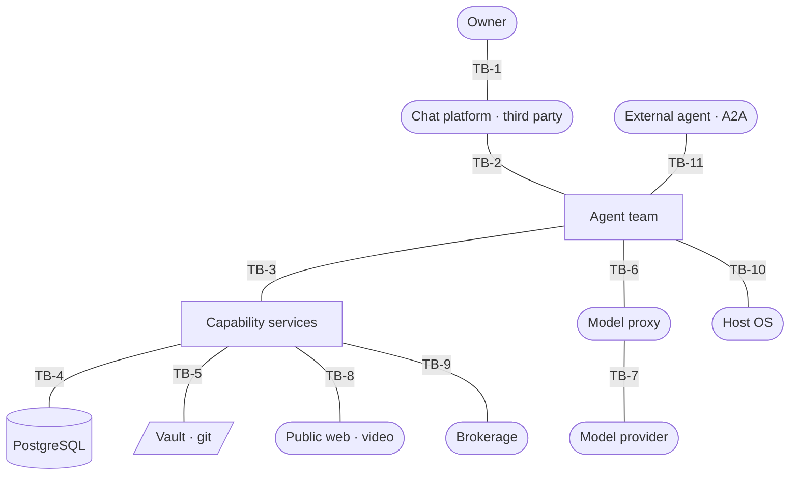

# Threat Model

> **Placeholders.** Where a control depends on an unresolved question in
> `docs/SRS.md`, this document carries a `[PENDING — SRS Q<n>]` marker rather
> than an assumed value. Nothing marked that way has been guessed.

**Why this document is mandatory.** Two triggers fire: the system stores
Confidential data (financial records, journal entries — SRS §7.1), and it both
accepts input from and sends data to third parties (public web, video sources,
model provider, brokerage, rate data). Either alone would require it.

**The central finding, stated up front.** This system has no meaningful
external adversary. Nothing is publicly reachable, there is no second user, and
there is no asset an outsider both wants and can reach. Nearly every credible
threat here originates *inside the trust boundary* — an agent taking an action
the owner did not intend, whether because a model produced it or because
content the system was asked to read instructed it to.

That inverts the usual weighting. Perimeter controls are cheap and already in
place. The controls that matter are the ones that bound what the system may do
on its own.

---

## 1. Trust boundaries

Boundaries drawn from the topology in `docs/ARCHITECTURE.md` §1. Each is a
place where data crosses between levels of trust.

| ID | Boundary | What crosses | Controlled at source by | Authenticated by |
| :--- | :--- | :--- | :--- | :--- |
| TB-1 | Owner → chat platform | Instructions, approvals | The owner | Platform account |
| TB-2 | Chat platform → agents | Messages claiming to be from the owner | A third party | Sender identity allowlist |
| TB-3 | Agent → capability service | Tool invocations | An LLM — **untrusted output** | Declared capability set |
| TB-4 | Service → database | Reads and writes | The service | Per-service database role |
| TB-5 | Service → vault | Note file writes | The service | Filesystem permissions |
| TB-6 | Agent → model proxy | Prompts, including ingested content | The agent | Proxy key |
| TB-7 | Proxy → model provider | Prompt content leaves the machine | The proxy | Provider key over TLS |
| TB-8 | Service → public web | Fetched content **enters** the system | **Nobody — fully untrusted** | None |
| TB-9 | Service → brokerage | Position and market data | The brokerage | Brokerage credential |
| TB-10 | Agent → host OS | Shell commands | An LLM — **untrusted output** | Command allowlist + scoped privilege |
| TB-11 | External agent → system | Delegated task and result | **A party outside this system** | Declared identity + capability set |

**The three that carry nearly all the risk:** TB-3 and TB-10, where
model-generated output becomes action; and TB-8, where wholly untrusted
content enters and is subsequently fed to a model across TB-6.

---

## 2. STRIDE findings

Only boundaries with findings are listed. Categories yielding nothing are
marked N/A rather than padded.

### TB-2 — Chat platform → agents

| ID | STRIDE | Threat | L × I | Disposition |
| :--- | :--- | :--- | :--- | :--- |
| T-01 | Spoofing | Someone other than the owner instructs an agent. | Low × High | **Mitigate** — instruction accepted only from the owner's identity; every other sender ignored. *(FR.06.2.3, AC.08)* |
| T-02 | Spoofing | The platform account itself is compromised, and the attacker is then indistinguishable from the owner. | Low × High | **Accept** — the platform account is the root of trust for the whole system. Mitigation is account hygiene outside this system's control. Recorded in `docs/SECURITY.md`. |
| T-03 | Information disclosure | The third-party platform holds the full history of the owner's conversations, including financial figures and journal content. | High × Medium | **Accept** — inherent to using a hosted platform as the surface. Alternative is self-hosting the surface, deferred. |
| T-04 | Denial of service | The platform is unavailable; all interaction stops. | Medium × Medium | **Accept** — no external party is harmed by an outage; availability is not the primary quality attribute *(ARCHITECTURE §7)*. Scheduled work must still record its own failure *(FR.02.2.3)*. |

Tampering, Repudiation, Elevation: N/A at this boundary.

### TB-3 — Agent → capability service *(highest priority)*

| ID | STRIDE | Threat | L × I | Disposition |
| :--- | :--- | :--- | :--- | :--- |
| T-05 | Elevation | An agent invokes a capability outside its mandate. | Medium × High | **Mitigate** — capability sets are declared; anything outside is not merely refused but invisible to the agent. *(FR.06.1.2)* |
| T-06 | Tampering | An agent writes data belonging to another domain. | Medium × High | **Mitigate** — each service reaches only its own schema, enforced below the application layer. *(FR.06.1.3, NFR.11, AC.03)* |
| T-07 | Tampering | An agent takes a state-changing action the owner never intended. | **High × High** | **Mitigate** — every state change is presented and executes only on explicit approval. *(FR.06.2.1, AC.01)* See T-08 for the residual. |
| T-08 | Tampering | The owner approves a harmful action because the request was plausible. | Medium × High | **Accept, with mitigation** — approval requests must state the action and its effect legibly *(FR.06.2.2, NFR.19)*. **No automated inspection of the proposed action exists.** This is the system's largest residual risk. *(AC.02)* |
| T-09 | Repudiation | An agent's action cannot be attributed after the fact. | Medium × Medium | **Mitigate** — every change recorded with its acting agent, before and after state, and timestamp. *(FR.06.3.1)* |
| T-10 | Elevation | An agent acquires capability at runtime that was never declared. | Low × High | **Mitigate** — no runtime installation, no lazy capability acquisition. *(NFR.12, AC.04)* |
| T-11 | Denial of service | An agent consumes inference budget without bound, through a loop or a runaway delegation. | Medium × Medium | **Mitigate** — ceiling enforced at the proxy; delegation bounded in depth and concurrency. *(NFR.13, FR.06.4.4, AC.06)* Ceiling figure `[PENDING — SRS Q3]`; delegation bounds `[PENDING]`. |

### TB-4 — Service → database

| ID | STRIDE | Threat | L × I | Disposition |
| :--- | :--- | :--- | :--- | :--- |
| T-12 | Tampering | The record of what the system did is altered or deleted to conceal an action. | Low × High | **Mitigate** — no service role holds UPDATE or DELETE on the audit record. Append-only by grant, not by discipline. *(FR.06.3.2, AC.07)* |
| T-13 | Tampering | Input reaching a query alters its meaning rather than its parameters. | Medium × High | **Mitigate** — every value crosses as a bound parameter. No query is assembled by string composition. |
| T-14 | Information disclosure | A compromised service reads another domain's data. | Low × High | **Mitigate** — per-service roles, grants scoped to owned schemas only. *(NFR.11)* |
| T-15 | Denial of service | A single query exhausts the shared connection pool or memory on a co-resident machine. | Medium × Medium | **Mitigate** — bounded result sets and query timeouts; the database is co-resident with everything else *(C-03)*. |

### TB-5 — Service → vault

| ID | STRIDE | Threat | L × I | Disposition |
| :--- | :--- | :--- | :--- | :--- |
| T-16 | Tampering | A note path derived from input escapes the vault directory and writes elsewhere on the host. | **High × High** | **Mitigate** — every resolved path must be contained within the vault root; anything else is refused. Note paths originate in model output *(TB-3)* and in fetched content *(TB-8)*, so this input is untrusted twice over. |
| T-17 | Tampering | A write leaves the file and its index inconsistent. | Medium × Medium | **Mitigate** — a half-completed write is reported as failure, never as success. *(FR.05.3.2, F-08)* |
| T-18 | Information disclosure | Journal content — the most sensitive data held — is exposed through search results to an agent that should not read it. | Low × High | **Mitigate** — only the assistant writes and reads personal journal content; other agents hold no capability for it. |

### TB-6 / TB-7 — Agent → proxy → model provider

| ID | STRIDE | Threat | L × I | Disposition |
| :--- | :--- | :--- | :--- | :--- |
| T-19 | Information disclosure | Financial figures, journal text and vault content leave the machine as prompt content to a third-party provider. | **High × High** | **Accept** — unavoidable for a system built on hosted inference. The owner should know that any data an agent reasons over is transmitted. Recorded in `docs/SECURITY.md`. *Eliminate option: local inference for the journal domain — not adopted, noted as a future decision.* |
| T-20 | Information disclosure | A secret is included in prompt content or echoed in output. | Medium × High | **Mitigate** — secret patterns redacted from tool output before an agent sees them. Best-effort filter, explicitly not a guarantee. *(NFR.10, AC.05)* |
| T-21 | Denial of service | The proxy is unavailable and every reasoning capability stops. | Medium × High | **Open — undecided.** Whether the system degrades to non-reasoning recording or fails loudly is SRS open question 2. **This must be settled before service contracts are written.** |
| T-22 | Spoofing | The provider key is stolen and used elsewhere. | Low × Medium | **Mitigate** — key held only by the proxy, encrypted at rest, never in an agent's reach. Spend ceiling bounds the damage. |

### TB-8 — Service → public web *(the injection surface)*

| ID | STRIDE | Threat | L × I | Disposition |
| :--- | :--- | :--- | :--- | :--- |
| T-23 | Elevation | Fetched content contains instructions; the model reads them as direction and proposes an action. | **High × High** | **Mitigate** — the approval gate is the control: injected instructions cannot change state without the owner's confirmation *(FR.06.2.1)*. Combined with minimal per-agent capability, blast radius is bounded. **Residual is T-08** and it is real. *(AC.02)* |
| T-24 | Elevation | A supplied URL causes the system to fetch a loopback or private-network address, reaching services that trust the local network. | **High × High** | **Mitigate** — reject non-public schemes and private address ranges before fetching, and revalidate after every redirect. The machine runs a loopback model proxy holding provider keys, which makes this directly exploitable rather than theoretical. |
| T-25 | Denial of service | A fetched resource is unbounded in size or never completes, exhausting memory on the co-resident machine. | Medium × Medium | **Mitigate** — response size cap and request timeout on every fetch. Values `[PENDING]` — depend on NFR.01/NFR.02, themselves `[PENDING — SRS Q4]`. |
| T-26 | Tampering | Content extraction invokes an external tool with an argument derived from input. | Medium × High | **Mitigate** — arguments passed as a vector, never through a shell; the identifier validated against an expected form before use. |
| T-27 | Information disclosure | A fetch reveals the owner's interests or location to an arbitrary third-party server. | Medium × Low | **Accept** — inherent to fetching a URL the owner asked for. |

### TB-9 — Service → brokerage

| ID | STRIDE | Threat | L × I | Disposition |
| :--- | :--- | :--- | :--- | :--- |
| T-28 | Elevation | A capability that moves money or places an order is reachable. | Low × **Critical** | **Eliminate** — no order-placing capability exists anywhere in the system. Not disabled, not gated: absent. *(FR.07.1.2)* |
| T-29 | Tampering | A stored copy of positions diverges from the brokerage and a decision is made on the stale figure. | Medium × High | **Eliminate** — no independent copy is kept; the brokerage is the sole record. *(FR.07.1.3)* |
| T-30 | Information disclosure | Brokerage credentials are exposed to an agent. | Low × High | **Mitigate** — credentials held by the service; agents hold only tool access. |
| T-31 | Tampering | A screening outcome is stated from an input that could not be retrieved. | Medium × High | **Mitigate** — a missing input yields an explicit inconclusive result; every figure carries source and as-of date. *(FR.07.3.2, FR.07.3.3, AC.10)* |

### TB-10 — Agent → host OS *(highest-privilege boundary)*

| ID | STRIDE | Threat | L × I | Disposition |
| :--- | :--- | :--- | :--- | :--- |
| T-32 | Elevation | A command outside the intended set is executed on the host. | Medium × **Critical** | **Mitigate** — one agent only holds host access; commands restricted to an explicit allowlist; elevated privilege scoped to named operations rather than granted broadly. |
| T-33 | Elevation | An allowlisted command is composed or parameterised to do more than intended. | Medium × High | **Mitigate** — allowlist matches whole invocations, not prefixes. Argument interpolation into a shell is prohibited. *This is the failure mode of most command allowlists and deserves an adversarial test.* |
| T-34 | Elevation | Recurring work is scheduled that then runs unattended and unreviewed. | Low × High | **Mitigate** — scheduling denied by default; permitted only where a mandate requires it. *(AC.09)* |
| T-35 | Denial of service | Automated restart cycles indefinitely against a component that cannot recover. | Medium × Medium | **Mitigate** — bounded attempts, then escalation to the owner. *(FR.04.2.2)* Retry bound `[PENDING — SRS Q6]`. |
| T-36 | Repudiation | A host action is taken without a record of what ran. | Medium × Medium | **Mitigate** — every attempted command and its outcome recorded and reported. *(FR.04.3.1)* |

### TB-11 — External agent → system *(A2A)*

This boundary does not exist yet. It is modelled now because the containment
model must be designed before the interface is opened, not retrofitted onto it.

| ID | STRIDE | Threat | L × I | Disposition |
| :--- | :--- | :--- | :--- | :--- |
| T-37 | Spoofing | An unauthorised party presents itself as a permitted external agent. | Medium × High | **Mitigate** — an external agent's identity is declared and verified before any task is accepted. |
| T-38 | Elevation | An external agent reaches capability beyond its declared set, or bypasses the approval gate. | Medium × **Critical** | **Mitigate** — an external agent is bound by exactly the same approval gate and capability scoping as an internal one. Interoperation widens *who may participate*, never *what may happen unapproved*. *(FR.06.4.2, NFR.21)* |
| T-39 | Repudiation | An action contributed by an external agent is indistinguishable from an internal one in the record. | Medium × Medium | **Mitigate** — external identity recorded on every action it takes or contributes to. *(FR.06.4.3)* |
| T-40 | Tampering | A result returned by an external agent is treated as trusted and acted on. | **High × High** | **Mitigate** — a returned result is untrusted content, equivalent to TB-8. It must not become action except through the approval gate, and it must not be interpolated into a command or a query. |
| T-41 | Denial of service | Delegation across the boundary recurses or fans out without bound. | Medium × Medium | **Mitigate** — depth and concurrency bounded, including across the system boundary. *(FR.06.4.4)* Bounds `[PENDING]`. |

---

## 3. Abuse case coverage

Every `AC.xx` from SRS §7.2 mapped to the boundary where it applies. No abuse
case is unaddressed.

| AC | Abuse case | Boundary | Threats |
| :--- | :--- | :--- | :--- |
| AC.01 | Agent takes an unintended state-changing action | TB-3 | T-07 |
| AC.02 | Ingested content carries instructions the system follows | TB-8, TB-6 | T-23, T-08 |
| AC.03 | Agent reads or writes outside its mandate | TB-3, TB-4 | T-06, T-14 |
| AC.04 | Agent acquires capability at runtime | TB-3 | T-10 |
| AC.05 | Secret exposed in output or version control | TB-6 | T-20 |
| AC.06 | Inference budget consumed without bound | TB-6 | T-11 |
| AC.07 | Agent alters the record of what it did | TB-4 | T-12 |
| AC.08 | An identity other than the owner instructs the system | TB-2 | T-01 |
| AC.09 | Unattended recurring work is scheduled | TB-10 | T-34 |
| AC.10 | A financial figure is stated from unretrieved data | TB-9, TB-6 | T-31 |

---

## 4. Disposition summary

| Disposition | Count | Threats |
| :--- | :--- | :--- |
| **Mitigate** | 27 | Become controls in `docs/SECURITY.md` and tickets at planning |
| **Accept** | 6 | T-02, T-03, T-04, T-08, T-19, T-27 — each recorded with a reason |
| **Eliminate** | 2 | T-28, T-29 — capability and stored copy both absent by design |
| **Open** | 1 | T-21 — blocks service contract design |

### High × High threats

Five. Four are mitigated; one is open.

| ID | Threat | Status |
| :--- | :--- | :--- |
| T-07 | Unintended state change | Mitigated by the approval gate |
| T-16 | Path escape from the vault | Mitigated by containment check — **must be adversarially tested** |
| T-23 | Instruction injection via ingested content | Mitigated by the approval gate; residual T-08 accepted |
| T-24 | Fetch redirected to a private address | Mitigated by scheme and range rejection — **must be adversarially tested** |
| T-40 | External agent result treated as trusted | Mitigated by treating it as untrusted content |
| T-19 | Confidential data transmitted to the model provider | **Accepted**, not mitigated — inherent to hosted inference |

No unmitigated high × high threat remains, so planning is not blocked on this
document. T-21 is open but is a design question, not an unaddressed threat.

---

## 5. Controls requiring an adversarial test

A control with no test that tries to defeat it is unverified. Each of these
needs a test that supplies the hostile input and asserts refusal.

| Control | Test | Threats |
| :--- | :--- | :--- |
| Vault path containment | A note path escaping the vault root is refused. | T-16 |
| Fetch address filtering | Loopback, private-range and redirect-to-private targets are all refused. | T-24 |
| Command allowlist | An invocation composing or extending an allowlisted command is refused. | T-33 |
| Capability scoping | An agent invoking a capability outside its set fails, and the capability is not visible to it. | T-05 |
| Schema isolation | A service reaching another domain's schema is refused by the database. | T-06, T-14 |
| Audit immutability | An attempt to update or delete a change record is refused by grant. | T-12 |
| Sender identity | A message from any identity other than the owner produces no action. | T-01 |
| Approval gate | A state change without a recorded approval does not execute. | T-07 |
| Query parameterisation | A value containing query syntax is stored as data, not interpreted. | T-13 |
| External agent scoping | An external agent's action without approval does not execute. | T-38 |

---

## 6. Open items

1. **T-21 — behaviour when inference is unavailable.** Degrade or fail loudly?
   Changes every service contract. SRS open question 2.
2. **T-11 — no spend ceiling figure.** The control is designed; the number is
   missing. SRS open question 3.
3. **Retention periods** `[PENDING — SRS Q5]`. Several disclosure threats
   (T-03, T-19) are bounded in practice by how long data is kept. No retention
   period is set for any category, so that bound is currently undefined.
4. **T-19 — data residency of journal content.** Accepted for now. If local
   inference for the journal domain is ever wanted, it is an architectural
   decision worth recording before the assistant is built.

---

## 7. When to re-run

Re-run this document when a trust boundary changes: a new external integration,
a new data category, a new agent with host access, the A2A interface actually
opening, or any move away from single-user. A threat model written once
describes a system that no longer exists.
