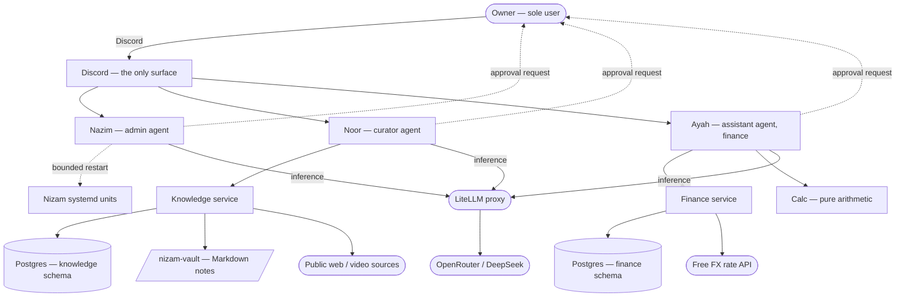

# Software Requirements Specification

**Project:** nizam-os
**Scope:** Personal domain, cycle 1: knowledge and personal finance. Tasks/habits/journal, self-maintenance and investment review are CP.02/CP.04/CP.05/CP.07 below, marked **DEFERRED** — their requirements are preserved for when cycle 2 starts, but nothing in this document authorizes building them now.
**Status:** LOCKED for cycle 1. Every open question from the prior draft is resolved below or explicitly still open (§12).

This document reuses the customer-problem/customer-need/functional-requirement structure and content of the prior SRS (v0.1.0, 2026-09-10) rather than re-deriving it — that interrogation was thorough and correct, and re-running it would waste the owner's time. What changed here: every `[CONFIRM]` marker is resolved, one way or another, and cycle 2 domains are explicitly cut out of this build's scope rather than left ambiguously "in".

---

## 1. Introduction

### 1.1 Purpose

nizam-os is a private AI operating system for a single person. It replaces the manual operational work of one owner's personal life with a small team of autonomous agents, each owning a domain, all reachable through a single chat surface. The purpose of this document is to state what the cycle-1 personal system must do, traced from the owner's problems through to testable requirements.

### 1.2 Scope

**In scope, cycle 1:**
1. **Personal finance** (CP.01) — current costs and forward planning, including zakat.
2. **Learning and knowledge** (CP.03) — capture, retention and retrieval of what the owner reads and studies.
6. **Autonomy with guardrails** (CP.06) — the agent runtime rules every domain obeys: approval gate, capability scoping, audit trail.

**Deferred to cycle 2 — do not build without a fresh go-ahead:**
2. Personal tracking (CP.02) — tasks, habits, goals, journal.
4. Self-maintenance (CP.04) — the system watches and repairs its own infrastructure.
7. Investment review (CP.07) — brokerage synthesis with religious compliance screening.

**Out of scope, indefinitely.** The business domain in its entirety. *"Let me limit myself only to the personal aspect for now; once I master and build a proper system that can help manage the personal things, we can then move to business."* Business is a later cycle with its own requirements pass, not a backlog item within this one.

Also out of scope: multi-tenancy or distribution of any kind, general-purpose assistant behaviour, and any agent operating outside its declared domain.

### 1.3 Definitions and Acronyms

| Term | Meaning |
| :--- | :--- |
| Owner | The single human user of the system (Danish). Also its technical operator. |
| Agent | An autonomous LLM-driven process with a defined mandate, its own memory, and a scoped set of tools. Implemented as a Hermes profile. |
| Service | A backing process exposing tools to agents over MCP. Agents hold no direct database access. |
| Vault | The owner's knowledge store: Markdown notes with structured frontmatter, held in the `nizam-vault` git repository. |
| Approval gate | The rule that a state-changing action is presented to the owner and executed only after explicit confirmation, in Discord. |
| Guardrail | A constraint that bounds autonomous action — scoped tool access, an allowlist, or a database grant. |
| Sub-unit | The smallest denomination of a currency (fils, cents, paisa). All stored monetary amounts are integers in sub-units. |
| CP / CN / FR / NFR / AC | Customer Problem / Customer Need / Functional Requirement / Non-Functional Requirement / Abuse Case. |

### 1.4 References

- `docs/reqs/raw.md` (in the export bundle this superseded) — the interrogation record behind the original draft.
- `docs/ARCHITECTURE.md` — how the system is built. Deliberately not referenced by any requirement here; requirements stay in the problem space.
- `docs/specs/001-knowledge.md`, `002-finance.md`, `003-calc.md`, `004-agent-runtime.md` — the interface contracts that implement CP.03, CP.01 (partly via calc), and CP.06 respectively.

---

## 2. Problem Classification

**Notation:** `[Subject] [must/expects/hopes] [Object] [or Penalty]`

| ID | Problem Statement | Class | Cycle |
| :--- | :--- | :--- | :--- |
| CP.01 | The owner **expects** to understand where his money goes — both overspending and underspending — or he continues operating blind on personal finances with no means of finding out. | E | 1 |
| CP.02 | The owner **expects** not to depend on his own memory for tasks and commitments, or he continues to miss deadlines. | E | **2 — deferred** |
| CP.03 | The owner **expects** to retain and retrieve what he learns — he reads and studies heavily and has no system for note-taking or for finding things again — or the reading does not compound. | E | 1 |
| CP.04 | The owner **expects** the system to look after itself, infrastructure and application alike, or its upkeep becomes another manual task and defeats its purpose. | E | **2 — deferred** |
| CP.05 | The owner **expects** personal tracking — tasks, habits — to live in one agentic surface rather than several separate mobile applications, or the fragmentation is itself the overhead. | E | **2 — deferred** |
| CP.06 | The owner **expects** the operational work of his life to happen without his manual effort, or it is done manually or not at all, consuming attention he wants spent on larger decisions. | E | 1 (runtime rules, cross-cutting) |
| CP.07 | The owner **expects** to reach an investment decision on his own terms — including compliance with his religious constraints — without reading every annual report himself, or he either invests without due diligence or does not invest at all. | E | **2 — deferred** |

**Zakat — RESOLVED 2026-09-26: Obligation-grade correctness, Expectation-class problem.** The owner confirmed zakat arithmetic should be treated as strict: exact, auditable, no silent rounding shortcuts, documented nisab/hawl logic. This does not reclassify CP.01 as an Obligation (there is still no external penalty for the *system* failing — the owner bears any consequence of a wrong religious calculation himself, same as before) but it does raise the correctness bar specifically for zakat arithmetic within CP.01/FR.01.5.x above every other financial calculation. See `docs/specs/002-finance.md` §Zakat and `docs/specs/003-calc.md`.

---

## 3. Overall Description

### 3.1 Product Perspective (cycle 1)

The system boundary contains the three cycle-1 agents, the knowledge and finance services, the pure calc module, the Postgres datastore and the vault. Outside it: the owner, the model provider reached only through the LiteLLM proxy, public knowledge sources, and the FX rate API. Every dashed edge is load-bearing — every state-changing action must be able to reach back to the owner for approval.

### 3.2 Customer Needs (cycle 1 only)

**Notation:** `[Subject] needs [system] to [Verb] [Object] [Condition]`

| ID | Need Statement | Outcome Class | Traces To |
| :--- | :--- | :--- | :--- |
| CN.01.1 | The owner needs the system to record every personal transaction at the moment he reports it, without him opening an application. | Construction | CP.01 |
| CN.01.2 | The owner needs the system to report where his money went over a period, broken down so that over- and under-spending are both visible. | Information | CP.01 |
| CN.01.3 | The owner needs the system to report his current position across all accounts he holds, in a single figure he can act on. | Information | CP.01 |
| CN.01.4 | The owner needs the system to compare actual spending against what he intended to spend, so a deviation is visible before the period ends. | Information | CP.01 |
| CN.01.5 | The owner needs the system to compute his zakat obligation when it falls due, from his own holdings and the prevailing threshold, exactly and auditably. | Information | CP.01 |
| CN.03.1 | The owner needs the system to take in a source he has found — a link, a video, a document — and turn it into a durable, retrievable note without manual filing. | Construction | CP.03 |
| CN.03.2 | The owner needs the system to classify what it captures, so that he never supplies the taxonomy himself. | Control | CP.03 |
| CN.03.3 | The owner needs the system to find a note again from a description of its meaning, not only from its exact words. | Information | CP.03 |
| CN.03.4 | The owner needs the system to show him what it intends to store before it stores it, so that a wrong capture is caught at the point of capture. | Information | CP.03 |
| CN.06.1 | The owner needs the system to act on its own within stated limits, so that routine work does not wait on his attention. | Control | CP.06 |
| CN.06.2 | The owner needs the system to obtain his confirmation before any action that changes state, so that autonomy never becomes an unwanted action. | Control | CP.06 |
| CN.06.3 | The owner needs the system to record every change it makes, attributed to the agent that made it, so that its behaviour is reviewable after the fact. | Construction | CP.06 |
| CN.06.4 | The owner needs the system to accept a new agent, including one built elsewhere, without its existing agents being modified to accommodate it. | Control | CP.06 |

**CP.02, CP.04, CP.05, CP.07 customer needs** are preserved verbatim in the archived 2026-09-10 SRS (`export/docs/SRS.md` in the handoff bundle) for reuse when cycle 2 starts. Not reproduced here to keep this document scoped to what's being built now.

### 3.3 User Personas

Unchanged from the prior draft:

- **The owner (sole user).** Keeps the operational layer of his life current — money recorded, sources captured — without opening an application, remembering to do it, or logging into a server.
- **The owner as operator (same person, different mode).** Understands what the system did, corrects it when wrong, and extends it — without re-reading its source code to recall how it works.

No second persona. Single-user by design.

### 3.4 Constraints

| # | Constraint | Origin |
| :--- | :--- | :--- |
| C-01 | Single owner. No second user, no roles, no tenancy, no external access surface. | Owner's stated scope. |
| C-02 | Discord is the only interaction path. No web UI, no mobile app, no server login in normal operation. | CN.06 family, standing decision. |
| C-03 | Self-hosted on a single VPS: 2 vCPU, 7.8 GB RAM, ~96 GB disk, Ubuntu 24.04. Cost is a fixed annual sum; the machine is not elastic. | Existing deployment (Hostinger). |
| C-04 | All model inference passes through one local LiteLLM proxy to OpenRouter, using DeepSeek models. No component reaches an external model provider directly. | Cost control, key containment, standing model preference. |
| C-05 | No component is reachable from the public internet other than SSH via Tailscale. | Existing posture. |
| C-06 | Every state-changing action requires the owner's approval via Discord. Read-only actions do not. | CN.06.2. |
| C-07 | Personal-domain, cycle-1 scope only (knowledge + finance). Cycle 2 and business are out. | Owner's scope cut, 2026-09-26. |
| C-08 | Monetary amounts are held as integers in currency sub-units, rounded half-to-even. No floating-point arithmetic on money. | RESOLVED 2026-09-26 — see NFR.05. |
| C-09 | This is a from-scratch rebuild (`export/00-START-HERE.md`) — a prior implementation existed and is not reused directly, only its proven ideas and documented bugs. | Owner decision, 2026-09-26. |
| C-10 | Multi-currency: AED, USD, INR. FX rate from a free external API, fetched and cached, never presented without its as-of time. | RESOLVED 2026-09-26 — see §6, §7. |

### 3.5 Delivery Team & Existing Stack

The owner is the sole builder and maintainer, working with an AI coding assistant (Claude Code — a planning session at high reasoning effort, implementation at a faster/cheaper model tier). The stack: Python (uv-managed) for services, shell for provisioning, PostgreSQL for storage, systemd for process supervision, Hermes for the agent runtime, Discord for the surface.

Delivery capacity: not formally timeboxed. Build in small, independently-verified vertical slices (see `export/00-START-HERE.md` phases) rather than against a calendar deadline — appropriate for a one-person, non-contractual project.

---

## 4. External Interface Requirements

### 4.1 Hardware Interfaces

A single self-hosted VPS of fixed capacity (2 vCPU, 7.8 GB RAM). Memory is the binding constraint: the agent team, the services, the datastore and the observability stack are co-resident. No component may assume it can scale horizontally, and no two heavy scheduled processes may start at the same wall-clock time.

### 4.2 External Software Systems

| System | Role | Failure posture |
| :--- | :--- | :--- |
| Discord | The sole owner-facing surface. | Hard dependency. Unavailable means no interaction at all. Scheduled work (none in cycle 1 beyond background jobs) continues and delivers on recovery. |
| LiteLLM proxy → OpenRouter (DeepSeek) | All agent reasoning, embeddings. | **RESOLVED 2026-09-26 (was Q2): degrades, does not fail loudly.** A tool that needs the LLM for a non-essential part of its work (classification, embedding) still completes the deterministic part of the write and marks the derived part `pending`, retried by a background job. A tool that is *purely* reasoning (e.g., answering a question) fails explicitly when the proxy is down — there is no deterministic fallback for that case. |
| Public web and video sources | Material for knowledge capture. | Soft. A failed fetch fails one capture; the system retries via an alternate extraction method before reporting failure (FR.03.1.3). |
| Free FX rate API | Currency conversion for multi-currency reporting and zakat. | Soft, but a stale figure must never be presented as current — see FR.01.3.2. If unreachable, the system states that a figure could not be converted rather than guessing. |

### 4.3 Communication Protocols and Formats

- Owner ↔ system: natural-language conversation in Discord.
- Agent ↔ capability service: MCP tool invocation over `127.0.0.1` only (the `nizam-mcp` daemon). Agents never address the datastore directly.
- Notes: Markdown with structured frontmatter, in the `nizam-vault` git repository. The file is authoritative; any indexed copy is derived and rebuildable.
- Monetary values: integer sub-units with an explicit currency code (AED, USD, or INR). Never a float, at rest or in transit between components.

---

## 5. Functional Requirements

RFC 2119 keywords. Every FR traces to a CN and transitively to a CP. Cycle-1 domains only (CP.01, CP.03, CP.06); CP.02/04/05/07 FRs are preserved unchanged in the archived prior SRS for cycle 2.

### CP.01 — Personal finance

| ID | Traces To | Priority | Requirement | Acceptance Criteria |
| :--- | :--- | :--- | :--- | :--- |
| FR.01.1.1 | CN.01.1 | MUST | The system shall record a personal transaction from a natural-language statement by the owner, capturing amount, currency (AED/USD/INR), account, direction, category, date and counterparty. | A stated transaction is retrievable with every field populated; an unstated date defaults to the current date. |
| FR.01.1.2 | CN.01.1 | MUST | The system shall reject a transaction whose category is outside the owner's defined vocabulary, rather than inventing one. | A transaction with an unknown category is refused and the owner is asked to choose or define one. |
| FR.01.1.3 | CN.01.1 | MUST | The system shall store all monetary amounts as integers in the currency's smallest sub-unit, rounded half-to-even at every computation boundary. | No stored monetary value is a floating-point number. A round-trip of any amount returns it exactly. |
| FR.01.1.4 | CN.01.1 | SHOULD | The system shall record a transfer between two accounts the owner holds as a single transfer, preserving sent and received amounts separately when currencies differ. | A cross-currency transfer records both amounts, the FX rate and its as-of time, and any fee, and does not appear as unexplained spending. |
| FR.01.1.5 | CN.01.1 | MUST | Transaction entry in cycle 1 is manual (owner-stated in Discord) only. Bank CSV import is out of scope for cycle 1. | No CSV/file-import tool exists in the finance service in cycle 1. |
| FR.01.2.1 | CN.01.2 | MUST | The system shall report total spending for a stated period, broken down by category. | For any closed period the sum of category totals equals the period total, in the reporting currency. |
| FR.01.2.2 | CN.01.2 | MUST | The system shall report spending for a period against the comparable prior period, so that a change in direction is visible. | The report states the difference per category, in both absolute and proportional terms. |
| FR.01.2.3 | CN.01.2 | SHOULD | The system shall spread irregular and recurring costs across the months they cover when reporting monthly cash flow. | An annually-billed subscription appears as a monthly figure in a monthly report, not as a single spike. |
| FR.01.3.1 | CN.01.3 | MUST | The system shall report the current balance of every account the owner holds, **derived from the transaction ledger** (sum of transactions, reconciled against periodic statement entries), and a single total across them in a chosen reporting currency. | The total equals the sum of per-account balances converted at a stated rate. No separately-maintained balance field exists that could drift from the ledger. |
| FR.01.3.2 | CN.01.3 | MUST | The system shall state the FX rate and its as-of time whenever it presents a converted total. | No converted figure is presented without its rate and timestamp. |
| FR.01.4.1 | CN.01.4 | SHOULD | The system shall hold an intended spending ceiling per category per month. | At most one ceiling is active per category at a time. |
| FR.01.4.2 | CN.01.4 | SHOULD | The system shall report actual spending against the intended ceiling before the period ends. | A category exceeding its ceiling is surfaced during the month, not after it closes. |
| FR.01.5.1 | CN.01.5 | MUST | The system shall compute the zakat obligation on demand from zakatable holdings and the prevailing nisab threshold, to obligation-grade correctness (exact `Decimal` arithmetic, no shortcuts, every step documented and reproducible). | The computation states the threshold used, its source, its as-of time, the holdings included, the nisab/hawl logic applied, and the resulting obligation. A second run against the same inputs produces the identical figure. |
| FR.01.5.2 | CN.01.5 | MUST | The system shall refuse to present a zakat figure computed from a threshold or FX rate it could not retrieve. | A failure to obtain a current threshold or rate produces an explicit failure, never a figure derived from a stale or default value. |

### CP.03 — Learning and knowledge

| ID | Traces To | Priority | Requirement | Acceptance Criteria |
| :--- | :--- | :--- | :--- | :--- |
| FR.03.1.1 | CN.03.1 | MUST | The system shall accept a web link, a video link, or a document from the owner and produce a note containing the extracted content and its provenance. | The resulting note records the source, its retrieval time, and the extracted text. |
| FR.03.1.2 | CN.03.1 | MUST | The system shall persist a note as a file in the owner's vault, with the file as the authoritative copy. | The vault file exists and is complete; any index entry is derivable from it. |
| FR.03.1.3 | CN.03.1 | SHOULD | The system shall recover from a failed content extraction by attempting an alternative method before reporting failure. | A source that one method cannot extract is attempted by at least one other before the owner is told it failed. |
| FR.03.2.1 | CN.03.2 | MUST | The system shall propose the classification of a captured note — its title, subject **areas** (multi-valued, from a controlled vocabulary, overlap expected) and tags — without requiring the owner to supply them. | The owner is never asked to enter a taxonomy value manually. A note may carry more than one area. |
| FR.03.2.2 | CN.03.2 | MUST | The system shall restrict proposed subject areas to a controlled vocabulary, while leaving supplementary tags unrestricted. | A note's areas are always drawn from the defined vocabulary; tags may be arbitrary. |
| FR.03.3.1 | CN.03.3 | MUST | The system shall retrieve notes matching a description of their meaning, not only their literal wording. | A query phrased differently from a note's text still returns that note when the meaning corresponds. |
| FR.03.3.2 | CN.03.3 | SHOULD | The system shall combine meaning-based and word-based retrieval into a single ranked result where both are available. | A query whose terms appear literally and a query that only matches semantically both return the relevant note. Implementation must not retry a failed query on a poisoned transaction (see `export/BUGS-AND-GOTCHAS.md` #1) — prefer a single reliable method over an unreliable hybrid if the fusion approach can't be made safe. |
| FR.03.3.3 | CN.03.3 | MUST | The system shall continue to return word-based results when meaning-based retrieval is unavailable (LLM/embedding path down), and shall say that it has degraded. | Loss of the embedding path degrades retrieval quality but does not fail the query, and the degradation is stated to the owner. |
| FR.03.4.1 | CN.03.4 | MUST | The system shall present the complete proposed note — content, title, classification and destination — to the owner and shall write it only after explicit approval. | No vault file is created without a preceding approval. Rejection leaves no trace in the vault. |
| FR.03.4.2 | CN.03.4 | MUST | The system shall keep the vault index consistent with the vault's files. | An approved write appears in retrieval; a rejected draft never does. |

### CP.06 — Autonomy with guardrails

| ID | Traces To | Priority | Requirement | Acceptance Criteria |
| :--- | :--- | :--- | :--- | :--- |
| FR.06.1.1 | CN.06.1 | MUST | The system shall perform read-only actions without seeking approval. | A search, a lookup or a report executes directly. |
| FR.06.1.2 | CN.06.1 | MUST | The system shall restrict each agent to the specific capabilities its mandate requires, with capabilities outside that set unavailable to it. | An agent cannot invoke a capability outside its declared set, regardless of instruction. Enforced by the bearer-token-to-domain-scope mapping in `docs/specs/004-agent-runtime.md`, not by the LLM's judgment. |
| FR.06.1.3 | CN.06.1 | MUST | The system shall confine each capability's data access to the domain it owns. | A capability cannot read or write data belonging to another domain, enforced at the database-role/schema level. |
| FR.06.2.1 | CN.06.2 | MUST | The system shall present every state-changing action to the owner and execute it only after explicit approval. | No creation, modification, deletion or state-changing command executes unapproved. |
| FR.06.2.2 | CN.06.2 | MUST | The system shall present an approval request in terms that identify the action and its effect. | The owner can tell from the request alone what will change. |
| FR.06.2.3 | CN.06.2 | MUST | The system shall accept instruction only from the owner's own Discord identity, and shall ignore all others. | A message from any other identity produces no action. |
| FR.06.3.1 | CN.06.3 | MUST | The system shall record every change to owner data, attributed to the acting agent, with before and after state and a timestamp. | Every write is present in the audit record with its actor. |
| FR.06.3.2 | CN.06.3 | MUST | The system shall prevent modification or deletion of its own change record. | No component holds the ability to alter or remove a recorded change (append-only by grant). |
| FR.06.3.3 | CN.06.3 | SHOULD | The system shall record the cost of its own model usage, attributed to the agent incurring it. | Consumption is retrievable per agent over a period (LiteLLM spend tracking). |
| FR.06.4.1 | CN.06.4 | SHOULD | The system shall expose an interoperation interface by which an agent outside the system may be delegated a task and return a result, without any existing agent being modified. | A newly introduced agent participates without a change to another agent's definition. Not required to be built in cycle 1, but the tool-scoping design must not preclude it. |

---

## 6. Non-Functional Requirements

| ID | Category | Priority | Requirement | Target |
| :--- | :--- | :--- | :--- | :--- |
| NFR.01 | Performance | SHOULD | Knowledge retrieval response | p95 under 3 s for a vault of up to 10,000 notes. |
| NFR.02 | Performance | SHOULD | Recording a transaction or knowledge capture | p95 under 1 s from receipt of the confirmed instruction, excluding LLM reasoning time. |
| NFR.03 | Availability | SHOULD | Owner-facing availability | Best-effort; no formal SLA — single-user, no on-call. A component down for hours is inconvenient, not a crisis. |
| NFR.04 | Availability | MUST | Recovery from component failure | Nazim (admin agent) attempts one restart of a failed Nizam-owned unit within 5 minutes of detection, then escalates. Never more than one automatic retry. |
| NFR.05 | Correctness | MUST | Monetary arithmetic | Integer sub-unit arithmetic throughout, round-half-to-even. Zero floating-point operations on money. **RESOLVED 2026-09-26.** |
| NFR.06 | Correctness | MUST | Financial reporting | Category totals reconcile exactly to the period total, for every period, in every currency before conversion. |
| NFR.07 | Durability | MUST | Knowledge vault | The vault is version-controlled; no approved note is lost by a failure of any derived index. |
| NFR.08 | Durability | MUST | Index rebuildability | Any derived index can be reconstructed from the vault files alone. |
| NFR.09 | Security | MUST | Network exposure | No component listens on a public interface. Management access only over Tailscale SSH. |
| NFR.10 | Security | MUST | Secrets at rest | Secrets are stored age/sops-encrypted. No plaintext secret is committed to version control, ever — see `export/BUGS-AND-GOTCHAS.md` #3 for why this is written in blood. |
| NFR.11 | Security | MUST | Data isolation | Each capability holds access only to its own domain, enforced at the storage layer (DB role/schema) rather than by convention. |
| NFR.12 | Security | MUST | Autonomy containment | No component may install software at runtime or acquire capability not declared ahead of time. |
| NFR.13 | Cost | SHOULD | Inference spend visibility | Spend per agent is visible in Grafana. No hard ceiling enforced in cycle 1 (owner reviews manually); revisit if DeepSeek costs become material. |
| NFR.14 | Cost | MUST | Infrastructure | One VPS at a fixed annual cost. No component may require a second. |
| NFR.15 | Observability | MUST | Change attribution | Every data change is attributable to the agent that made it. |
| NFR.16 | Observability | SHOULD | Operational visibility | Component health, spend and error rate are visible in Grafana without inspecting a log by hand. |
| NFR.17 | Maintainability | MUST | Reproducible setup | Every provisioning step is idempotent — re-running it reaches the same state as running it once. |
| NFR.18 | Usability | MUST | Single surface | Every cycle-1 capability is reachable from Discord. |
| NFR.19 | Usability | SHOULD | Approval legibility | An approval request states the action and its effect without requiring the owner to inspect anything else. |
| NFR.20 | Retention | MUST | Data retention | Financial records, knowledge notes and the audit log are kept indefinitely (no auto-deletion). Operational logs (systemd/journald) rotate per `logrotate` policy — see `RUNBOOK.md`. **RESOLVED 2026-09-26.** |

---

## 7. Security & Data Constraints

### 7.1 Data classification

| Category | Examples | Sensitivity | Retention |
| :--- | :--- | :--- | :--- |
| Financial records | Account balances (derived), transactions, counterparties, categories | High | Indefinite |
| Knowledge notes | Captured content and its provenance | Low — largely public material | Indefinite |
| Operational records | Change log, health metrics, spend | Moderate | Indefinite for the audit log; rotated for raw logs |
| Credentials | Provider keys, tokens, database credentials | Critical | Until rotated |

No regulated category applies: no payment card data, no health/biometric data, no third party's personal data. No jurisdiction imposes a residency requirement, because no data subject other than the owner exists.

### 7.2 Abuse cases

The realistic adversary is not an external attacker — there is no public surface and nothing to gain. It is **the system's own autonomy**: a component acting on a bad instruction, whether hallucinated or injected through content the system was asked to read.

| ID | Abuse case | Control |
| :--- | :--- | :--- |
| AC.01 | An agent takes a state-changing action the owner did not intend. | FR.06.2.1 — approval precedes every state change. |
| AC.02 | Content the system ingests carries instructions, and the system follows them. | FR.06.2.1, FR.06.1.2 — approval gate plus minimal per-agent capability. Residual: a convincing request may still be approved. |
| AC.03 | An agent reads or writes a domain outside its mandate. | FR.06.1.3, NFR.11 — isolation enforced at the storage layer. |
| AC.04 | An agent acquires capability at runtime that was never declared. | NFR.12 — no runtime installation, no lazy capability acquisition. |
| AC.05 | A secret is exposed in agent output or committed to version control. | NFR.10. This happened once during the prior implementation's refactor attempt (untracked config file, caught before push) — see `export/BUGS-AND-GOTCHAS.md` #3. Gitignore every secret-shaped path before it's ever written to. |
| AC.06 | An agent consumes inference budget without bound. | NFR.13 — visibility, reviewed manually in cycle 1. |
| AC.07 | An agent alters or deletes the record of what it did. | FR.06.3.2 — the change record is append-only by grant. |
| AC.08 | An identity other than the owner instructs the system. | FR.06.2.3 — instruction accepted from the owner's Discord identity alone. |
| AC.09 | An agent schedules recurring work that then runs unattended and unreviewed. | Scheduling denied by default (Hermes `cron_mode: deny` on every profile). Cycle 1's timers — backup, embedding retry, metrics — are system jobs defined in `deploy/`, not agent-scheduled, and none mutates owner data beyond backfilling an embedding for an already-approved note. |
| AC.10 | The system reports a financial figure derived from data it failed to retrieve. | FR.01.5.2, FR.01.3.2 — a figure is never presented without its source and as-of time. |
| AC.11 | Nazim (admin) restarts a component outside its allowlist, or retries unboundedly. | NFR.04 — exactly one Nizam-unit restart, then escalate. Enforced by a narrow sudoers file, not by agent judgment alone. |

**Worst realistic outcome.** Loss or corruption of the owner's financial history, or an unwanted state-changing action taken on his behalf. No regulatory exposure, no third-party harm. Effort is weighted toward *containing autonomy* and *preserving the record*, not perimeter defence.

### 7.3 Access model

Single identity. No roles, no tenancy, no sharing. Isolation is between *agents and capabilities*, not between users. An append-only record of every change, attributed to the acting agent, is required (FR.06.3.1). Its reader is the owner.

### 7.4 Compliance

None. No framework applies contractually or regulatorily. Recorded explicitly so the absence is a finding, not an omission.

---

## 8. Operational Constraints

| Question | Position |
| :--- | :--- |
| Who finds out first when it breaks? | The system itself (Nazim), then the owner by Discord report. |
| What recovery happens without the owner? | One restart attempt of exactly one of: `litellm-proxy`, `nizam-mcp`, `hermes-gateway-curator`, `hermes-gateway-assistant` — bounded by NFR.04. Enforcement per unit type is in `SECURITY.md` (sudoers for system units, the Hermes command allowlist for user units). |
| What must never be attempted unattended? | **RESOLVED 2026-09-26.** Postgres, Redis, and any host-level/system unit. No file edits. No installation of anything. Nazim's sudoers file enforces this at the OS level, not just in its prompt. |
| Scale | One user. Growth is in vault size and transaction history, not concurrency. |
| On-call | None. |
| Acceptable downtime | No formal target — best-effort (NFR.03). |
| Behaviour when inference is unavailable | **RESOLVED 2026-09-26 — see §4.2 and F-01.** Deterministic writes succeed and queue the reasoning-dependent part; purely-reasoning requests fail explicitly. |

---

## 9. Failure Modes

| # | Failure | Consequence | Required behaviour |
| :--- | :--- | :--- | :--- |
| F-01 | Inference path (LiteLLM) unavailable | No agent can reason. | **RESOLVED:** deterministic recording/reporting degrades gracefully (queues the LLM-dependent part); purely-reasoning capabilities fail explicitly and say why. |
| F-02 | Discord unavailable | Total loss of interaction. | Cycle 1's scheduled work — nightly backup, embedding retry, metrics — needs no Discord and continues regardless. Approvals cannot happen while Discord is down; drafts stay valid for 24h (Q-A1). |
| F-03 | Datastore unavailable | No recording, no reporting. | Refuse and say so. Never accept an instruction that will not persist. |
| F-04 | Classification is wrong | Content is filed incorrectly and becomes unfindable. | Approval gate is the control (FR.03.4.1). Correction after the fact must be possible (a re-classify tool). |
| F-05 | Meaning-based retrieval unavailable | Knowledge becomes hard to retrieve. | Degrade to word-based retrieval and state the degradation (FR.03.3.3). |
| F-06 | Storage exhausted | Writes fail, potentially silently. | Detect before exhaustion (disk-space metric, alert threshold); refuse rather than fail silently. |
| F-07 | Zakat/FX figure input unavailable | Financial figures cannot be computed correctly. | Refuse to present a figure. Never substitute a stale value (FR.01.5.2, FR.01.3.2). |
| F-08 | Injected content causes an unwanted action to be proposed | Owner approves something harmful. | Approval gate plus minimal capability. Residual risk accepted (AC.02). |
| F-09 | A DB query fails mid-transaction and a retry runs on the same poisoned connection | Every subsequent query on that connection fails with a confusing "transaction aborted" error until the connection is discarded. **This happened in the prior implementation** — see `export/BUGS-AND-GOTCHAS.md` #1. | Any fallback-on-error code path must rollback or open a fresh connection/savepoint first. Tested explicitly (see `docs/specs/001-knowledge.md` test requirements). |

---

## 10. Success Metrics

| Tier | Metric | Target |
| :--- | :--- | :--- |
| **Primary** | The owner stops using any separate application or spreadsheet for personal finance tracking and note-taking, replacing both with Discord conversation through nizam-os. | Qualitative — the owner reports (to himself, honestly) that he's actually doing this, 30 days after cycle-1 agents go live. |
| Secondary | Sources captured per week via Noor. | No fixed figure — track it, watch the trend. |
| Secondary | Transactions recorded conversationally vs. lapsing back to manual/nothing. | Trending toward "conversationally", not a hard number. |
| Guardrail | Approved actions the owner later regrets. | Zero. Any occurrence is a defect in the approval presentation. |
| Guardrail | Any secret ever appearing in git history. | Zero. |
| Guardrail | Owner sessions logged directly into the machine for routine operation. | Trending to zero — Discord and Grafana should cover routine needs. |

---

## 11. Traceability Matrix (cycle 1)

| CP | CN | FR |
| :--- | :--- | :--- |
| CP.01 — Money is invisible | CN.01.1 Record transactions | FR.01.1.1–5 |
| | CN.01.2 Report where it went | FR.01.2.1–3 |
| | CN.01.3 Report current position | FR.01.3.1–2 |
| | CN.01.4 Actual against intended | FR.01.4.1–2 |
| | CN.01.5 Compute zakat | FR.01.5.1–2 |
| CP.03 — Reading does not compound | CN.03.1 Capture a source | FR.03.1.1–3 |
| | CN.03.2 Classify it for me | FR.03.2.1–2 |
| | CN.03.3 Find it by meaning | FR.03.3.1–3 |
| | CN.03.4 Show before storing | FR.03.4.1–2 |
| CP.06 — Manual or not at all | CN.06.1 Act within limits | FR.06.1.1–3 |
| | CN.06.2 Confirm before changing | FR.06.2.1–3 |
| | CN.06.3 Record what it did | FR.06.3.1–3 |
| | CN.06.4 Admit a new agent | FR.06.4.1 |

CP.02/04/05/07 traceability is preserved unchanged in the archived prior SRS for cycle 2.

### Zigzag validation

- [x] Every cycle-1 CP has ≥ 1 CN.
- [x] Every CN traces to exactly one CP.
- [x] Every CN has ≥ 1 FR.
- [x] Every FR traces to exactly one CN.
- [x] No orphan FR.
- [x] Every abuse case AC.01–AC.11 maps to a control that is an FR or NFR.
- [x] Every `[CONFIRM]` from the prior draft is resolved below (§12) or explicitly still open.

---

## 12. Open Questions

All prior blocking questions, resolved:

1. ~~Zakat's class~~ — **RESOLVED:** strict/obligation-grade arithmetic, Expectation-class problem. See §2.
2. ~~Inference-down behaviour~~ — **RESOLVED:** degrade and queue. See §4.2, §8, F-01.
3. ~~Spend ceiling~~ — **RESOLVED:** visibility only in cycle 1, no hard ceiling (NFR.13).
4. ~~Latency/uptime targets~~ — **RESOLVED:** best-effort, no formal SLA (NFR.03, NFR.01, NFR.02).
5. ~~Retention~~ — **RESOLVED:** indefinite for financial/knowledge/audit data (NFR.20).
6. ~~Safe-autonomy boundary~~ — **RESOLVED:** Nizam-units only, one retry, then escalate (§8, NFR.04, AC.11).
7. ~~Investment review~~ — **RESOLVED (re-decided) 2026-09-26:** deferred to cycle 2, not built now. (The 2026-09-10 draft had put it in-scope; the owner's 2026-09-26 decision narrows cycle 1 to knowledge + finance only.)
8. ~~Success metric~~ — **RESOLVED:** see §10.
9. ~~Delivery capacity~~ — **RESOLVED:** no fixed timebox, small verified slices (§3.5).
10. ~~Habits/goals/journaling~~ — **RESOLVED (re-decided) 2026-09-26:** all deferred to cycle 2 along with the rest of CP.02/05.

**Genuinely still open, not yet needed for cycle 1:** none. Cycle 2 will need its own short interrogation before it starts (at minimum: safe-autonomy specifics for self-maintenance beyond what NFR.04 already covers, and the investment/brokerage integration details).
