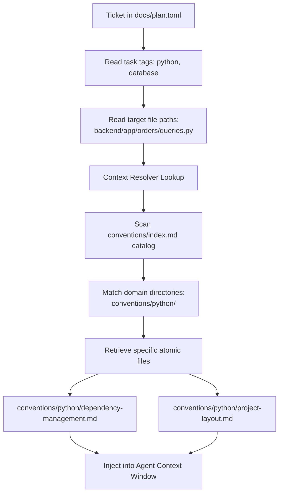

# Context Resolver Algorithm

The Context Resolver prevents **context collapse** by ensuring an agent never loads the entire `conventions/` folder. It performs Just-In-Time (JIT) retrieval of micro-standards based on task tags and target file paths.

---

## 1. Resolution Flow

When `/exec` executes a ticket from `docs/plan.toml`:



---

## 2. Rule Selection Criteria

An atomic standard inside `conventions/` **MUST** be fetched and appended to the system context if **ANY** of the following conditions evaluate to true:

1. **Tag Match:** A tag listed in the standard's YAML frontmatter (e.g., `tags: [mongodb, aggregations]`) matches an explicit tag in the execution ticket. This is the primary mechanism — the Planner (`agents/planner-agent.md`) is responsible for tagging tickets correctly, including mandatory tags (`coding-principles`, `tdd`, language `boundaries`) for every code-producing ticket.
2. **Extension / Path Match:** The target file path in `frontend/` or `backend/` matches the standard's language/framework scope — use as a fallback when a ticket's tags are underspecified:

- File ends in `.py` $\rightarrow$ Scan `conventions/python/index.md`
- File ends in `.go` $\rightarrow$ Scan `conventions/go/index.md`
- File ends in `.tsx`/`.ts` inside `frontend/` $\rightarrow$ Scan `conventions/nextjs/index.md` and `conventions/typescript/index.md`
- Action involves `git commit` $\rightarrow$ Scan `conventions/git/index.md`
- Action involves adding/updating a dependency $\rightarrow$ also check `conventions/git/dependabot.md`
- Action involves `Dockerfile`/`.dockerignore` $\rightarrow$ Scan `conventions/ops/index.md`

3. **Explicit Directive:** The task description explicitly names a convention (e.g., _"using UV workspaces"_).

Beyond the always-load floor below, nothing is loaded unconditionally. If a ticket is tagged correctly by the Planner, the resolver loads exactly what that ticket needs — no more.

**Never retrievable:** `feanor/docs/` is maintainer documentation *about* Feanor — descriptive, not normative. It contains no rule an execution agent should follow, and loading it would spend context on material that cannot change the code. The resolver **MUST NOT** return any file under `docs/`, regardless of tag or keyword match. Read it only when a human asks about Feanor itself.

**Profile-gated:** when `.feanor/profile.toml` exists, a convention belonging to a capability that is disabled there **MUST NOT** be loaded, even on an exact tag match — see §6.

---

## 3. Context Payload Cap

To maintain extreme reasoning speed and token efficiency:

- The Context Resolver **MUST NOT** load more than **10 atomic convention files** for a single ticket execution.
- If more than 10 files match, prioritize by:

1. **Security rules the ticket's tags or target files implicate** — `security.md`, `access-control.md`, `untrusted-input.md`, `auth.md`, `secrets-management.md`, `data-protection.md`. These are **never** dropped to make room.
2. Cross-stack principles named by mandatory tags: `coding-principles.md`, `tdd.md`, language `module-boundaries.md`
3. Primary language rules named by the ticket's language tag (e.g., `python/dependency-management.md`, `go/project-layout.md`)
4. Other domain-specific rules named by the ticket's domain tags (e.g., `python/database.md`, `cross-stack/rate-limiting.md`)
5. Git/DevOps rules (e.g., `git/commit-format.md`)

### Always-load floor

Regardless of tags, and regardless of the cap:

- **Every** ticket loads `git/commit-format.md`. Every ticket ends in a commit, so the rules for shaping one apply universally. Reaching them by tag never worked: `git` sits at priority 5 and application tickets are not tagged `git`, so across a full live run these rules were never loaded once and the history came out as single commits of 74 files. A rule that always applies has to always load — priority 5 is the right rank for *ordering* it, and the wrong mechanism for *reaching* it.
- A ticket whose `target_files` include an HTTP handler, route, controller, Server Action, or resolver **MUST** load `cross-stack/access-control.md`. Missing authorization is the most common serious defect in generated code, and it is invisible in a passing test suite — the happy path succeeds identically with and without the check.
- A ticket tagged `auth`, `security`, or any of their language-qualified variants **MUST** load `cross-stack/security.md`.
- A ticket that reads a URL, path, uploaded file, or serialized payload from user input **MUST** load `cross-stack/untrusted-input.md`.

If the cap is genuinely reached with these loaded, split the ticket — a ticket needing more than 10 convention files is doing more than one thing, which `agents/planner-agent.md`'s atomic-isolation rule already forbids.

---

## 4. Tag → File Mapping

**The mapping is data, not a table in this file.** It lives in `conventions/tags.toml` and is applied by `scripts/resolve-context.py`:

```bash
uv run feanor/scripts/resolve-context.py   --tags coding-principles,tdd,python-boundaries,python,auth   --files backend/app/auth/router.py
```

The script prints the exact files to load, already ordered by the ladder in §3, deduplicated, profile-gated per §6, and capped. Add `--explain` to see why each file was chosen, `--list-tags` to see every tag, `--validate` to check the mapping's integrity.

**Run it rather than reasoning about the mapping.** Tag lookup, ordering, the always-load floor, and the cap each have exactly one correct outcome, so per `meta/determinism-standard.md` they belong in a tested script — a table an agent reads and re-applies by hand is a seam where two runs diverge. This mapping previously existed both here and in `agents/planner-agent.md`; the copies drifted, and nothing detected it.

**Aliases and language-qualified tags are handled by the script.** `go-auth`, `python-auth`, and `nextjs-auth` all resolve to `cross-stack/auth.md` — load only the section for the active language. Unknown tags produce a warning on stderr, not a silent miss.

**Adding a tag:** add an entry to `conventions/tags.toml` with its `files`, `priority` (§3's ladder), and optional `aliases` / `requires_capability`, then run `--validate`. Do not restate the mapping here or in any agent prompt.

---

## 5. Graphify Navigation (pre-resolution)

Before running the tag/extension lookup above, check whether a graphify knowledge graph exists for the current scope. Graphify query returns ranked, scoped results — cheaper than multi-file reads when the relevant file is uncertain.

**Optional accelerator — its absence is the normal case.** Most projects have no graph, the `test -f` check below simply finds nothing, and resolution proceeds by tag and path exactly as documented above. Skipping this step is not a failure and needs no report; graphify only ever saves reads, it never decides which conventions apply.

**Check and query (feanor docs scope):**

```bash
# Check if graph exists, then query
test -f feanor/graphify-out/graph.json && /graphify query "<question about conventions or feanor>"
```

**Check and query (project code scope):**

```bash
test -f graphify-out/graph.json && /graphify query "<question about codebase>"
```

Use graphify query results as **input to the tag/file lookup** — the returned file paths tell you which conventions to load, rather than guessing from tags alone. If no graph exists, fall back to the tag-based resolution above.

See `feanor/graphify.md` for build and update instructions.

---

## 6. Capability Profile Gate

`.feanor/profile.toml` (written by `/hld`, see `agents/architect-agent.md`) declares which capabilities this project actually has. It is a filter applied **after** tag and path matching, before the cap in §3.

```bash
# Is this optional capability enabled for this project?
uv run feanor/scripts/write-profile.py --check metrics
```

- **Optional capability disabled → its convention MUST NOT be loaded**, even on an exact tag match. Loading `metrics.md` into a project that declined metrics spends context on rules that must not be followed, and invites the agent to add an unwanted dependency.
- **Conditional trigger true → its conventions are mandatory**, and rank with the security tier in §3 rather than as ordinary domain rules. A project with `api = true` gets `api-design.md` whether or not the planner remembered the tag.
- **Baseline conventions are never listed in the profile and are never gated by it.** Their absence from the file means "always on", not "off". Never infer that a missing key disables `coding-principles.md`, `tdd.md`, or any of the security set.
- **No profile file → no gating.** Fall back to tag and path resolution alone. A brownfield project standardized before profiles existed must keep working.

Tier definitions and the full capability catalog: `docs/CAPABILITIES.md`.

---
