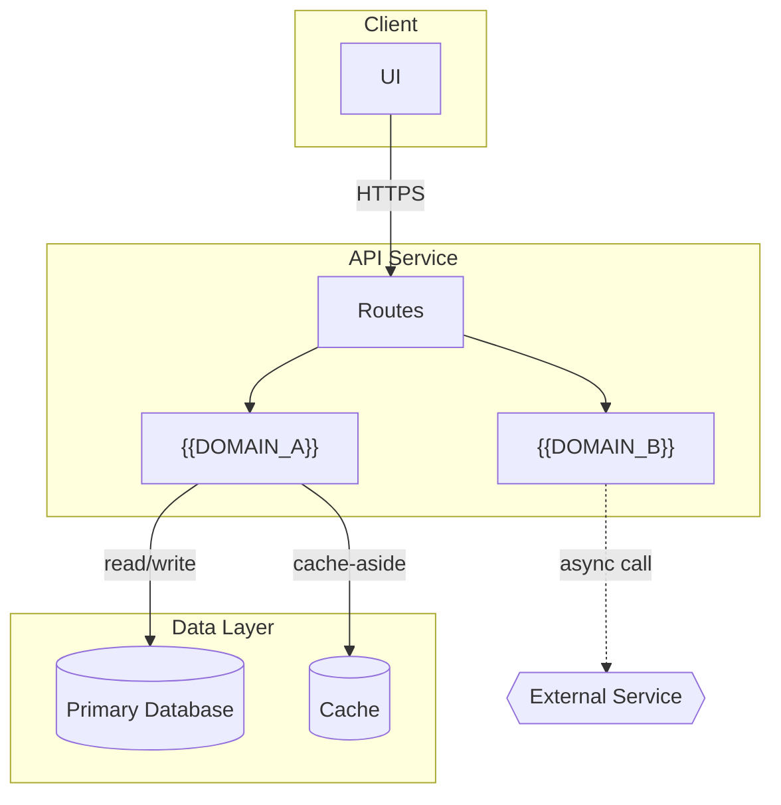
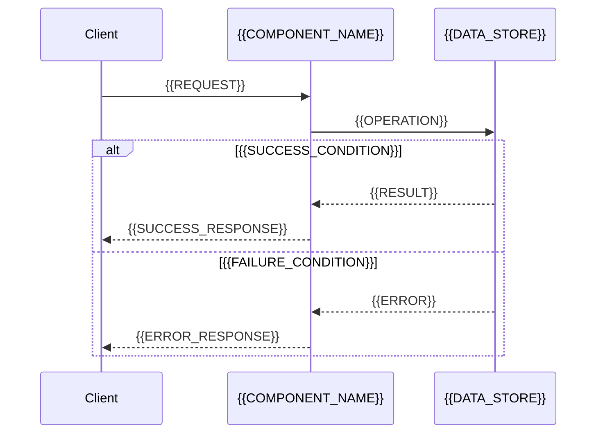

# Architecture

> **Project:** {{PROJECT_NAME}}

## Status

Canon — update this file whenever a component is added, replaced, or its role changes. Rollout/build progress belongs in `PLAN.md` (if generated), not here; this document describes the system as it stands, not the work remaining.

## System Topology

A Mermaid diagram that actually shows the system's shape, not a token placeholder — real node/edge richness, still generic (no real service names — see `diagrams-guide.md` for the same rule applied to the companion Excalidraw diagrams):

- **Group by layer with `subgraph`** when there's more than one — a flat node soup with 6+ boxes is harder to read than 2-3 labeled clusters.
- **Differentiate node shape by kind**: `[Rectangle]` for a service/process, `[(Cylinder)]` for a data store, `{{Hexagon}}` for an external system/third-party API. Shape carries meaning at a glance; don't make everything a rectangle.
- **Label edges with the actual relationship**, not a bare arrow: `-->|reads/writes|`, `-.->|async/LLM call|` (dashed for async or non-critical-path calls, solid for synchronous/critical-path). A diagram of unlabeled arrows forces the reader to guess.
- **Style out anything not on the live request path** (an offline seed script, a one-time migration tool) so it doesn't get mistaken for part of normal traffic flow — a dashed border or muted style, not removed entirely if it's still part of the system.
- **Multiple backend services (different languages or split by role) get their own subgraph each, with the actual inter-service call as a labeled edge between them** — sync HTTP (`-->|HTTP: POST /jobs|`) or async/queue-based (`-.->|enqueue|`), whichever the project actually uses. Don't leave inter-service communication undrawn just because it's "internal" — it's exactly the kind of relationship this diagram exists to make explicit.

Right-size this — a 3-component internal tool doesn't need subgraphs or a legend of shapes; the richness above is for when the system actually has enough moving parts that a flat diagram stops being readable.

## Tech Stack

| Layer     | Choice   | Why                           |
| :-------- | :------- | :---------------------------- |
| {{LAYER}} | {{TECH}} | {{JUSTIFICATION_AGAINST_PRD}} |

### Backend Language Decision

This subsection is required when the project has a backend. State the choice and the reasoning against the PRD's actual constraints — not generic language praise.

**Decision:** {{Python only | Go only | Python + Go (separate services)}}

**Reasoning:**

Apply these criteria against `docs/PRD.md` to reach the decision, then document which criteria drove it:

| Criterion              | Favors Python                                            | Favors Go                                                     |
| :--------------------- | :------------------------------------------------------- | :------------------------------------------------------------ |
| Workload type          | I/O-bound, scripting, data pipelines                     | CPU-bound, high-throughput, sustained concurrency             |
| LLM / ML integration   | Strong — LangChain, HuggingFace, NumPy are Python-native | Weak — no mature LLM orchestration ecosystem                  |
| Latency requirements   | Acceptable for most API workloads                        | Sub-millisecond, high fan-out, or large volume streaming      |
| Team fluency           | Team has shipped Python to production                    | Team has shipped Go to production                             |
| Project lifecycle      | Rapid iteration, smaller surface, one backend service    | Long-running service, performance envelope already hit        |
| Concurrency model      | Async (asyncio/FastAPI) covers most web needs            | Goroutine-per-request scales to very high concurrency cheaply |

**Team fluency carries the most weight of any row here, and it is a fact to look up — not an inference.** Read the "Delivery Team & Existing Stack" answers in `docs/SRS.md` (gathered at `/reqs` §2.8). Never infer team skill from the PRD's timeline or from how the project is written about. If that section is marked N/A because the team was not yet known, say so explicitly in the rationale below and choose for maximum conventionality instead — the most boring, widely-known option for the workload, since an unknown team cannot be matched.

**When to choose both:** only when two genuinely different services have requirements that point in opposite directions — e.g. a Python service for LLM orchestration and a Go worker for high-throughput event processing. Not "let's use both because we can." Each service must have an independent justification.

**Decision rationale (fill in):**

- Key PRD constraint(s) that drove the choice: {{CONSTRAINT}}
- Team fluency input used, and its source: {{SRS_SECTION_OR_"not captured — chose for conventionality"}}
- Why the alternative language(s) were ruled out: {{REASON}}
- If both: what each service is responsible for and why they can't share a runtime: {{SPLIT_REASON}}

## Components

One entry per component. Each entry answers three things and nothing else:

- **Owns:** what this component is solely responsible for — one sentence, no internals
- **Does not:** the most tempting thing a reader might assume it does, that it actually doesn't (omit if nothing is genuinely surprising)
- **Depends on:** other _components_ in this list, plus named external systems — not internal modules or packages

If an entry would just restate what the topology diagram already shows, skip it or cut it to the one fact the diagram can't carry. No internal implementation detail here — that belongs in specs or code.

### {{COMPONENT_NAME}} (`{{COMPONENT_DIR}}`)

- **Owns:** {{RESPONSIBILITY}}
- **Does not:** {{SURPRISING_NON_RESPONSIBILITY}}
- **Depends on:** {{OTHER_COMPONENTS_AND_EXTERNAL_SYSTEMS}}

## Data Flow (optional — only for workflows the topology diagram can't make clear on its own)

A sequence diagram per non-obvious workflow — not every endpoint, only the ones where the _order_ and _branching_ of calls is itself something a reader needs (a multi-step async process, a retry/fallback path, a streaming response). A simple CRUD endpoint doesn't need one; the topology diagram already says enough.

## Data Stores

One entry per store, separate from Components — what it holds and why it exists as its own store rather than folded into another one.

- **{{STORE_NAME}}:** {{WHAT_IT_HOLDS}} — {{WHY_A_SEPARATE_STORE}}

## Boundaries

- **Auth boundary:** {{WHERE_TOKENS_VALIDATED}}
- **Persistence boundary:** {{WHAT_CAN_TOUCH_THE_DB_DIRECTLY}}

## Cross-Cutting Concerns

Decisions that apply across every component, not owned by any single one — state them once here rather than letting each component reinvent (or silently diverge on) its own answer. Describe the actual approach standalone, in plain terms a reader can act on without any other file — **never link or reference `feanor/`/`conventions/`/`.feanor/` paths from this document.** Those are internal build-time tooling, stripped from the branch before it reaches `main` (see `git/branch-strategy.md`'s "Feanor Scoping"); `docs/` is a deliverable that persists past that point, so a reference into `feanor/` becomes a dead link exactly when this doc matters most — read by someone with no Feanor installed at all.

| Concern                              | Approach     |
| :----------------------------------- | :----------- |
| Auth & authorization                 | {{APPROACH}} |
| Logging                              | {{APPROACH}} |
| Error handling                       | {{APPROACH}} |
| Caching                              | {{APPROACH}} |
| Rate limiting                        | {{APPROACH}} |
| Configuration (major/minor tunables) | {{APPROACH}} |

Omit a row only if the project genuinely doesn't have that concern (e.g. no rate limiting needed for an internal tool with no public surface) — state that explicitly rather than leaving the row out silently, so a reader can tell "decided not needed" from "forgot to fill in."

**Architectural decisions that don't fit the table above** — a real trade-off or non-obvious enforcement choice worth stating explicitly, one line each:

- {{DECISION}} — {{WHY}}
